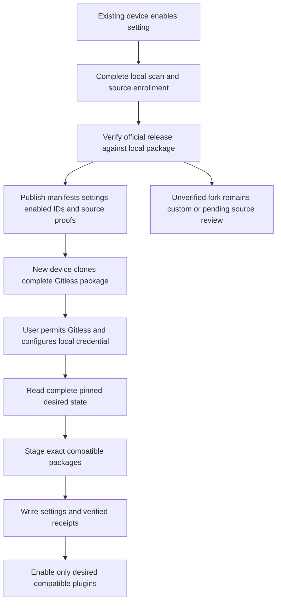
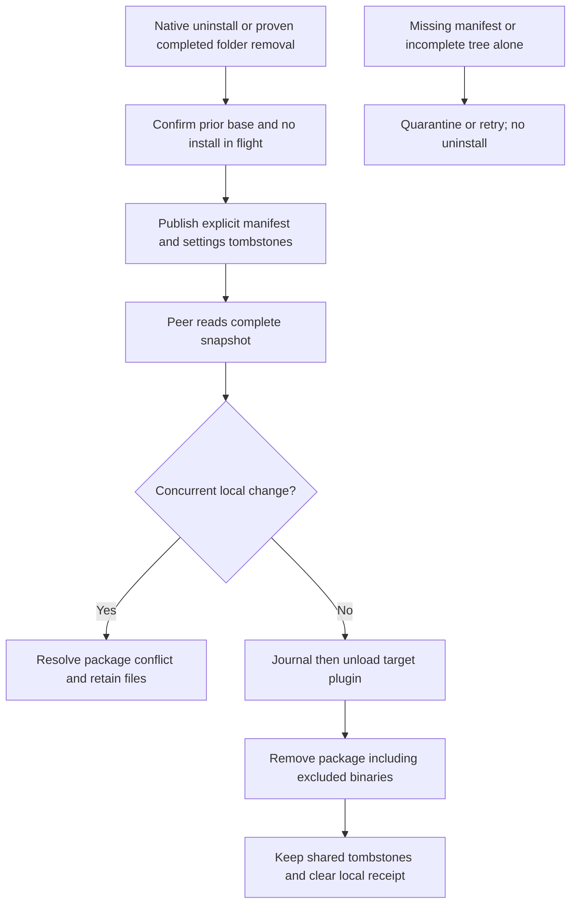
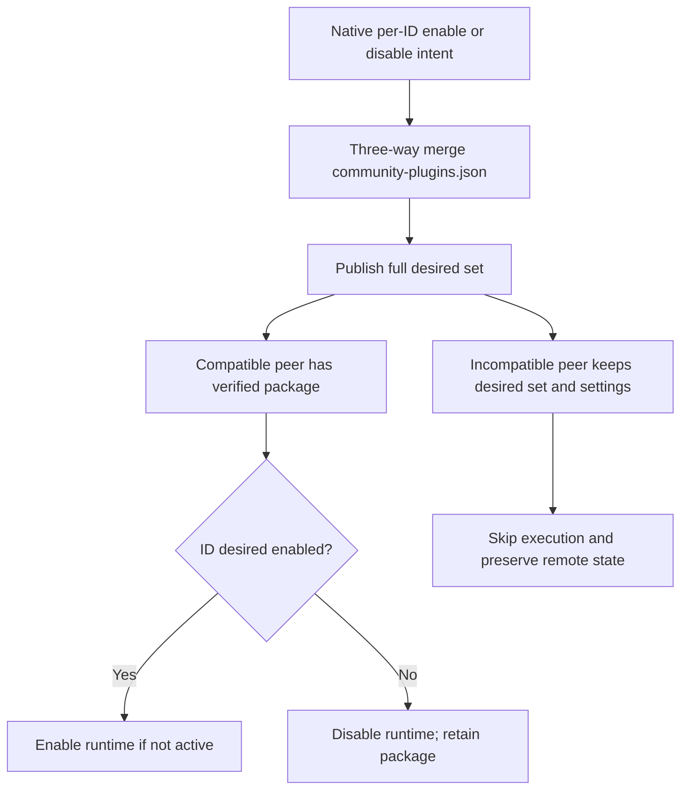

# Plan: Native community plugin synchronization for Gitless

## Scope and planning status

This plan implements opt-in native community plugin synchronization through an isolated reconciliation module integrated with Gitless's file-sync transaction. It includes install, exact-version update, uninstall, enable/disable, bootstrap, compatibility, settings, failure recovery, and migration. Gitless's complete plugin directory is always shared, including `data.json` and the configured GitHub token, as explicitly requested by the user. No token migration or redaction is part of this feature. No plugin inventory JSON file is introduced.

The user selected owning feature `community-plugin-sync`, requested exploration, and cleared Iris Gate G with `goal ok`. The architectural approach was already specified by the user: reuse native Obsidian files and Gitless metadata, keep ordinary binaries local, and prefer an isolated reconciler. Gate A is therefore not required. The original draft and research companions remain in `/private/tmp`; this executable copy is stored here after the user invoked iris-2-run-build.

Proposed repository destination, only after authorization to write planning files: `.knowledge/features/community-plugin-sync/plans/plan-native-community-plugin-sync.md`.

Grounding: [verified exploration](/private/tmp/gitless-community-plugin-sync-exploration.md). Impact analysis and ranked risks: [native-community-plugin-sync-impact.md](/private/tmp/native-community-plugin-sync-impact.md). Those documents are authoritative for evidence and risks; this plan describes the corresponding design and execution work rather than duplicating the impact analysis.

## 1. Current Architecture Assessment

### Verified revisions

| Source | Revision inspected |
|---|---|
| Local checkout | `1a363244a4b57647f4759f1702bb904329955af0` |
| Primary repository default branch | `793f8ec7e9b5a1c7261338d84d0216bbe68b2ac2` |
| Vault reference | `85af751ae7e5d458cda51da0ff5e1c260df9a525` |
| Hot Reload reference | `4c5454963ec4cbe847302d3063ada4b4204d7e95` |

Remote HEAD was rechecked during drafting and still matches those primary/vault revisions. Do not reset the local checkout during implementation: compare its state with the verified revision and preserve user edits. A pre-existing change to `.knowledge/features/sync/README.md` was observed and left untouched.

### Reusable mechanisms and exact gaps

| Mechanism | Reuse | Required change |
|---|---|---|
| `reconcileConfigDirFiles()` at `sync-manager.ts:839` | Adapter enumeration catches untracked config files. | Add a path-scoped plugin scan even when general config sync is off; classify stable reads and native mutations. |
| `calculateSHA()` / `determineSyncActions()` at lines 1305 / 1166 | Content-based adapter-write detection and generic file actions. | Managed plugin desired-state merge must precede generic action handling; ambiguous absence cannot fall into upload-to-delete conversion. |
| `EventsListener.onDelete()` | Existing file/folder tombstones. | Managed plugin manifest deletion must wait for uninstall evidence; ignore lifecycle-owned writes by exact content/generation. |
| `deleteLocalFile()` at line 1555 | Idempotent deletion of individual files. | Managed uninstall owns unload and removal of excluded package siblings; generic deletion alone is insufficient. |
| `commitSync()` at line 1347 | Git tree construction, conflict content publication, metadata serialization. | Explicit local/shared projection, pinned parent commit, change-aware metadata merge, staged config write integration. |
| `shouldSkipFile()` / `isPathSyncable()` | Existing default rules and preview integration. | Route every filter site through one policy; preserve legacy behavior when no managed protocol exists. |
| `computeExcludedRemoteOrphans()` at line 781 | Existing migration cleanup pipeline. | Distinguish package-binary cleanup from desired-plugin uninstall; protect self, custom exceptions, pending migration. |
| MetadataStore | Existing JSON file and serialized writes. | Add optional provenance and local operation receipts; repair queue recovery after a rejected save. |
| `firstSyncFromRemote()` | Sequential archive extraction. | Use unified policy and pinned archive revision; stage managed configs; never overwrite running Gitless through extraction. |
| Startup and settings in `main.ts` | Editor flush, interval/focus triggers, pending conflict session flow. | Inject lifecycle bridge, enable bounded scan scheduling, and recognize cloned shared metadata safely. |

There is currently no native package installer/reconciler. Local metadata has no actual-package receipt. Shared manifest version equality cannot establish binary equality. The reference QuickAdd script fetches HEAD and enables installations indiscriminately; none of those behaviors becomes the native contract.

## 2. Approach

System: one “Sync community plugins” toggle synchronizes community plugin choices and settings, then installs verified packages locally. Gitless's own package and settings are always shared independently of this toggle.

Extend Gitless's existing file transaction and introduce one small plugin-sync subsystem. Desired installed state remains the manifest file; desired enabled state remains `community-plugins.json`; settings remain `data.json`. Existing metadata gains only information absent from those files: source provenance, content baselines, and device-local operation success/recovery evidence. No inventory file, duplicate desired-ID list, duplicate installed-version inventory, QuickAdd dependency, or Hot Reload dependency is added.

Use official registry resolution plus exact GitHub release assets for managed packages. Implement preflight/staging with Obsidian `requestUrl` and the Vault adapter. Do not rely on undocumented `installPlugin()` to provide atomic writes or rollback. Only runtime load/unload and native mutation observation require a narrow internal plugin-manager bridge. This is a deliberate compatibility boundary with an executable contract gate before release.

Rejected alternatives:

- Synchronize all binaries: conflicts with the stated default, magnifies package churn, and still needs runtime lifecycle reconciliation.
- Copy the QuickAdd script: uses HEAD, loses disabled intent, and lacks update/uninstall recovery.
- Add another inventory: duplicates native desired state and introduces competing deletion authority.
- Extend only `SyncManager` with inline lifecycle logic: couples package recovery to ordinary file actions and makes no-action retries harder.
- Depend solely on `installPlugin(repo, version, manifest)`: its partial-write and settings semantics are not publicly guaranteed. The bridge may observe native calls, but Gitless's transaction owns its downloads and promotion.

### Goal critique accepted at Gate G

Doing nothing preserves today's script dependency and incomplete update behavior. Install-only scope is cheaper but does not satisfy update/uninstall requirements. The riskiest feasibility issue remains the internal lifecycle API contract across desktop and Android. Source inspection does not prove that contract. Phase 0 below resolves it using a fixed test harness; it is a release gate, not permission to improvise a different architecture.

## 3. State ownership and invariants

1. Only a validated desired manifest denotes installed intent. A missing binary never denotes uninstall.
2. Only `community-plugins.json` denotes enabled intent. The runtime active-plugin map is a separate observation.
3. A successful package receipt is written only after every required asset is promoted and rehashed.
4. Local receipts and journals never enter a Git blob, archive export, log payload, or remote merge.
5. A remote uninstall requires an explicit accepted tombstone plus a complete consistent snapshot. Tree absence, phantom-entry repair, filtering, metadata reset, and compatibility skips are not uninstall evidence.
6. A first initialization never infers local deletion from absent files. A missing baseline means adoption, not removal.
7. No package operation touches Gitless's runtime lifecycle. No active sync overwrites its package files.
8. Downloaded settings are applied after unload and before enable. Settings-only synchronization causes no reload.
9. Plugin writes are serialized. Native user mutations invalidate snapshots or wait during the short local promotion window.
10. File sync and package hydration have separate outcomes: a committed desired update can remain pending local installation and retry on a no-change sync.

### Persisted representation: existing metadata file only

Add optional fields to existing types. Names below are proposed interfaces, not existing code:

```ts
type PluginId = string;
type BlobSha = string;
type Sha256 = string;
type PackageAsset = "manifest.json" | "main.js" | "styles.css";

type PluginSourceProof = {
  kind: "official-release";
  repository: string;             // registry-approved owner/repo
  tag: string;                    // exact requested version, never HEAD/latest
  manifestSha256: Sha256;         // release manifest, before any local dir field
} & ({
  transport?: undefined;          // legacy API-based proof, still readable
  releaseId: number;
  assets: Partial<Record<PackageAsset, {
    assetId: number;
    sha256: Sha256;
  }>>;
} | {
  transport: "release-download";
  assets: Partial<Record<PackageAsset, { sha256: Sha256 }>>;
});                              // manifest and main required; CSS optional

interface FileMetadata {
  // Existing fields unchanged.
  pluginSource?: PluginSourceProof; // only on the desired manifest entry
  pluginDeletion?: {
    kind: "explicit-uninstall";
    baseManifestSha: BlobSha;
  };                              // only alongside a tombstone
}

interface PluginReceipt {
  targetManifestSha: BlobSha;
  sourceProofSha256: Sha256;
  mainSha256: Sha256;
  stylesSha256: Sha256 | null;
  runtime: "applied" | "enable-failed";
}

interface PluginOperation {
  id: PluginId;
  targetManifestSha: BlobSha | null;
  kind: "hydrate" | "uninstall" | "self-stage";
  phase: "prepared" | "unloaded" | "promoting" | "verified";
  stageDir: string;
  backupDir: string;
  rollbackManifestSha: BlobSha | null;
}

interface PluginLocalState {
  version: 1;
  repositoryKey: string;          // owner/repo/branch/configDir; reset on change
  baselineCommit: string | null;
  receipts: Record<PluginId, PluginReceipt>;
  operations: Record<PluginId, PluginOperation>;
  enabledBase: { blobSha: BlobSha; text: string } | null;
  configBase: Record<string, { blobSha: BlobSha; text: string }>;
}

interface Metadata {
  lastSync: number;
  files: Record<string, FileMetadata>;
  pluginSyncProtocol?: 1;
  localPlugins?: PluginLocalState;
}
```

`configBase` stores the last acknowledged managed config content needed for three-way merging; it is a conflict baseline, not an inventory. Limit it to managed manifests/data and the enabled-list baseline, discard entries after acknowledged uninstall, and do not copy binary contents into metadata. A cloned shared metadata file has no `localPlugins`. Even if users manually copy local metadata, verify receipts against the actual binaries and never derive removal intent from transferred state.

Concrete ephemeral contracts used by the phases:

```ts
interface ConfigValue {
  path: string;
  text: string;
  blobSha: BlobSha;
}

interface DesiredPlugin {
  id: PluginId;
  manifest: PluginManifest;
  manifestFile: ConfigValue;
  settingsFile: ConfigValue | null; // absent settings is valid, not uninstall
  settingsManaged: boolean;
  source: PluginSourceProof | null;
  ownership: "managed" | "custom" | "self";
}

interface AcceptedUninstall {
  id: PluginId;
  baseManifestSha: BlobSha;
  manifestTombstone: FileMetadata;
}

interface DesiredPluginState {
  plugins: ReadonlyMap<PluginId, DesiredPlugin>;
  uninstalls: ReadonlyMap<PluginId, AcceptedUninstall>;
  enabledIds: ReadonlySet<PluginId>;
  enabledFile: ConfigValue;
}

interface LocalPluginScan {
  generation: number;
  complete: boolean;
  desired: DesiredPluginState;
  actual: ReadonlyMap<PluginId, {
    mainSha256: Sha256 | null;
    stylesSha256: Sha256 | null;
    loaded: boolean;
  }>;
  ambiguousIds: ReadonlySet<PluginId>;
}

interface DesiredMerge {
  state: DesiredPluginState;
  deferredIds: ReadonlySet<PluginId>;
  conflicts: readonly PluginConflict[];
  expectedGeneration: number;
}

interface ResolvedPackage {
  manifest: PluginManifest;
  proof: PluginSourceProof;
  assets: ReadonlyMap<PackageAsset, ArrayBuffer>;
}

interface StagedPackage {
  id: PluginId;
  operationId: string;
  stageDir: string;
  targetManifestSha: BlobSha;
  proof: PluginSourceProof;
}

type PackageVerification =
  | { kind: "verified"; receipt: PluginReceipt }
  | { kind: "missing" | "mismatch"; assets: PackageAsset[] };
type SourceMismatch = { kind: "source-mismatch"; id: PluginId; reason: string };
type RemoteMetadata = Pick<Metadata, "lastSync" | "files" | "pluginSyncProtocol">;
type FileSnapshot = Record<string, FileMetadata>;
interface PluginIssue {
  id: PluginId;
  code: "incompatible" | "source-unverified" | "network" | "integrity"
    | "ambiguous-removal" | "conflict" | "runtime" | "self-update";
  message: string; // redacted, no plugin data or credential payloads
  retryable: boolean;
}
```

Export the existing `SyncAction` type from `sync-manager.ts` for the narrow prepared-config boundary. Keep immutable content/base views in these ephemeral structures; none is written as another inventory file. `PluginConflictSide` is `{ kind: "present"; manifest: ConfigValue; settings: ConfigValue | null } | { kind: "removed"; baseManifestSha: BlobSha }`, and `PluginConflictResolution` is `{ id: PluginId; choice: "local" | "remote" }`. Package conflict UI must not synthesize invalid manifest text or permit arbitrary executable-source URLs.

`toRemoteMetadata()` explicitly emits shared fields and shared per-file proofs; it never serializes `localPlugins`. `mergeRemoteMetadata()` validates and merges shared fields only. Unknown or malformed protocol data suspends plugin lifecycle and destructive plugin actions, while retaining ordinary file sync where safely separable.

Provenance is extra security information, not proof of a trusted publisher against a malicious vault collaborator. Anyone allowed to change the vault's trusted desired executable state can request code execution, including Gitless's bootstrap executable. Disclose that trust boundary when enabling the setting.

### Staging and crash recovery

Use `${configDir}/.gitless-plugin-staging/<id>/<operation-id>/` for asset and configuration buffers and backup files. It is an excluded working directory, not an inventory. Reject it before manual include rules. Record operation state in the existing metadata file; await durable save before each destructive phase. Never depend on `onunload()` awaiting an asynchronous flush for durability.

On startup, inspect operations before normal scanning. Validate canonical assets against the target proof. If all match, finish the receipt and clean staging; otherwise retry promotion from validated staging or restore validated backups and mark pending. No journal means no deletion authority. A journal failure prevents promotion. Rejected metadata writes must not poison the save queue permanently.

## 4. Filter precedence and settings UX

New boolean: `syncCommunityPlugins`, default `false` for existing and new installations. General `syncConfigDir` retains its current default.

Feature-on effective path order:

| Priority | Path class | Rule |
|---|---|---|
| 1 | Traversal/invalid plugin paths; staging; workspace/log artifacts | Reject regardless of patterns. Metadata path retains its existing special handling. |
| 2 | Gitless package directory | Share all files, including manifest/main/CSS/data.json and token, independent of `syncConfigDir`, plugin toggle, and patterns; stage incoming package writes. |
| 3 | Explicit custom full-directory exception | Existing include-over-exclude package transport remains; exclude from managed source hydration and lifecycle. |
| 4 | Managed enabled list, manifest, data | Always share regardless of general config toggle and broad manual plugin exclusions. |
| 5 | Managed main.js/styles.css and other package files | Remain local. Broad includes never accidentally opt into binary transport. |
| 6 | All other files | Existing policy, including include-over-exclude and `syncConfigDir`, unchanged. |

Custom exceptions are only exact plugin-root directory patterns such as `${configDir}/plugins/<id>/` or its equivalent `<id>/**`, not global `**`, `plugins/**`, or `**/main.js`. Their presence is a deliberate opt-out from managed installation. Preserve their files and ordinary file transport. They receive a settings description: “Custom package exceptions sync their own files; Gitless will not replace them from the community registry.” No new advanced setting is required.

The known QuickAdd full-directory exception is retired automatically only after its local package is verified against the exact official release and a successful migration commit exists. Remove the exact obsolete rule from the saved settings at that point. Until then preserve its binaries as migration-pending. Do not delete the reference script from the user's vault; cease all reliance on it and document that its QuickAdd automation can be disabled.

Feature-off behavior: with no `pluginSyncProtocol`, keep existing filtering and lifecycle behavior. Once a remote managed protocol exists, a disabled modern client must not reinterpret opt-out as uninstall or purge protocol-owned desired files/binaries through orphan cleanup; it abstains from plugin lifecycle and protects remote managed paths. Other legacy manual file rules remain effective. Turning the toggle off never uninstalls plugins or reverses migration automatically. This narrowly scoped protection is an intentional safety exception to legacy cleanup semantics.

UI: one toggle under sync settings, explanation that community plugin configuration sync works independently of general config sync, installs executable code from verified sources, and skips incompatible plugins. Gitless's own folder always syncs, including `data.json` and its token. Show migration/source failures inline as actionable status, not additional required toggles. An “Inspect plugin sync issues” command displays pending IDs/reasons, retry, and source review for exceptional unproven legacy packages. Reuse Obsidian's native plugin screen for ordinary install/enable/disable actions.

Aggregate notices only after changes: counts installed, updated, uninstalled, enabled/disabled; compatibility skips only when target/reason changes; persistent failure count with detail command; restart recommended only for actual unload/load failure or a staged Gitless update. No-op cycles remain quiet apart from existing file-sync feedback.

## 5. Package source policy and exact-version hydration

### Source verification

Resolve an ID using the official `obsidianmd/obsidian-releases` community registry fetched over HTTPS with an in-session cache. Pin the registry response hash for the scan. Restrict repositories to valid GitHub `owner/repo` names, and restrict downloads to GitHub's documented release endpoints and GitHub-owned asset delivery hosts. Never attach the vault repository token to registry or public release/asset requests.

For a requested manifest version `V`, request `GET /repos/{owner}/{repo}/releases/tags/{V}`. Require an exact version-named release; no fallback to HEAD, latest, or an arbitrary similarly named tag. A plugin using a nonstandard tag is unsupported in v1 and can retain a custom directory exception. Download release `manifest.json`, `main.js`, and optional `styles.css` by the selected release's asset identities. Validate release manifest ID, version, `minAppVersion`, and desktop compatibility against the desired manifest. Permit only known nonidentity manifest fields such as the local `dir` to differ; canonicalize them consistently. No executing/evaluating a binary for verification.

Compute SHA-256 over downloaded assets, validate GitHub's digest when supplied, and bind asset IDs/hashes into `PluginSourceProof`. On future hydration require that proof and recheck current release metadata; a changed asset identity/hash at the same version is a blocked mutable-release event, not an automatic update. Initial hashes establish integrity and subsequent consistency, not independent publisher signatures. A missing stylesheet means remove the previous managed stylesheet during promotion.

Limits: 1 MiB manifest, 25 MiB main.js, 5 MiB CSS, two concurrent network downloads maximum, one package promotion at a time. Exceeding limits gives an unsupported-package error and preserves current files. Use `AbortSignal` where supported; otherwise ignore late results by generation after unload/cancellation. Do not add a Node fs dependency.

### Fork ambiguity and legacy migration

An official ID does not prove that a local or remote package came from that official repository. Before publishing source proof on an originating device, compare local executable/CSS hashes and canonical manifest identity with that exact official release. If bytes differ, do not replace them, publish official provenance, or clean up remote binaries. Mark source-unverified and preserve a custom exception.

A fresh device can automatically hydrate a manifest-only package when accepted metadata already carries source proof. A pre-feature manifest-only vault with no such proof cannot distinguish a same-ID fork safely. Migration therefore needs verification on a device with the original binaries, or one-time explicit source approval for that legacy package in the issues command. This is a real information limitation, not solvable from a standard manifest alone. After enrollment, normal device installs and updates propagate automatically.

Native new installation on A is observed after completion; verify its bytes against the registry release, associate source proof with that manifest, and publish it on the next sync. If offline, preserve native files and defer provenance/publication of an executable request until verified; notes can still sync. Source approval never automatically trusts arbitrary URLs supplied in a manifest.

### Actual versus desired state

Hash the local managed main.js/CSS on each plugin reconciliation (bounded to managed packages); compare with the proof/receipt, not just the live manifest version. Reuse a successful receipt only if target manifest hash, proof hash, and actual asset hashes agree. Cache bytes/hashes within one scan, never trust mtime alone across scans.

If a manifest changes from v1 to v2 while old main.js remains, the target/proof/asset comparison fails and schedules hydration. If the desired files have not changed but the last update failed, the incomplete journal or missing receipt still schedules hydration. If binaries already match the proof and the runtime instance is correct, no download or reload occurs.

## 6. Core reconciliation and conflict algorithms

### Complete snapshots and ordering

Acquire a pinned remote snapshot: read branch commit C, read its commit/tree, and fetch the metadata/config blobs from that immutable tree. Reject a truncated recursive tree for plugin decisions; implement non-recursive subtree traversal to obtain completeness. Fetch bootstrap archives by C rather than a moving branch. Validate that live desired manifests have real tree entries. Phantom entries are quarantined for managed plugins, never converted into explicit uninstall tombstones.

Capture local plugin configuration twice across a quiescent adapter scan with no observed native mutation generation change. Validate JSON before treating it as desired state. A malformed/missing enabled list is unavailable, not `[]`. Read failures suspend the affected group's destructive actions.

```ts
async function reconcileCycle(): Promise<PluginSyncReport> {
  return coordinator.runExclusive(async () => {
    await metadata.recoverLocalOperations();
    const before = await plugins.scanLocal();
    const remote = await github.getSnapshot(); // pinned commit + complete tree
    const merged = await plugins.mergeDesired(before, remote);
    // An unresolved plugin conflict defers only that plugin's lifecycle group.
    const actions = await planFileActionsWithPluginOverrides(merged);
    const prepared = await plugins.prepareConfigWrites(actions, merged);
    await applyOrdinaryFileActions(actions); // managed config stays staged
    await plugins.assertLocalGeneration(before.generation);
    const result = await commitAgainst(remote.commitSha, prepared, actions);
    await plugins.acceptPublishedState(result, prepared);
    // Runs even when no file actions and no new commit were necessary.
    return plugins.reconcilePublishedDesiredState(result);
  });
}
```

Prepare any needed package source proof before publishing its manifest. Network package bytes can be staged in advance, but installation and activation happen only against accepted desired state. A Git publication failure does not trigger uninstall or activate an unaccepted remote update.

Native user installs/updates during network work advance a local generation; abort/recompute the plugin portion before publishing stale config. Queue native user mutations only during short promotion/unload/settings-write windows, not during network downloads or conflict UI waits. At most three immediate snapshot rebuild attempts; then defer plugin work to the next trigger, keeping note sync usable.

### Three-way merging

Use last acknowledged content/hash as base, local observation L, and pinned remote R. Compare content identities, not clocks:

```text
L == base                         -> accept R
R == base                         -> accept L
L == R                            -> accept either
otherwise                         -> typed plugin conflict
```

Manifest conflict compares complete validated identities; never select highest version as an implicit winner, since intentional downgrade is valid. Update-versus-uninstall is a conflict even when generic remote content is null. Keep local package and defer removal until explicit resolution. For destructive/version conflicts do not apply generic note overwrite preferences automatically; show Keep local / Use remote with package/version/removal context. Reuse the existing conflict session infrastructure without encoding deletion as an empty JSON file.

Merge `community-plugins.json` as per-ID membership deltas over the base set. Unchanged membership accepts the other side's change; additions of different IDs combine; per-ID incompatible intent or unavailable base is surfaced when both sides diverge. Sort only for deterministic output, not to choose winners. Independently merge data.json with the existing file conflict policy; do not deep-merge arbitrary plugin settings. Uninstall-versus-settings modification is a package conflict, preserving settings until resolved.

No-base initialization adopts the complete remote desired state plus nonconflicting local additions. Same-ID differences become conflicts. Never derive removals from the absence of local receipts or a missing metadata file.

### Local removal evidence

Wrap successful native uninstall completion through the bridge, without changing its result or call semantics; confirm manifest and folder absence by adapter scan. That observation plus a previously acknowledged manifest base produces `pluginDeletion.kind = "explicit-uninstall"` and existing file tombstones for manifest/settings. Native update/install calls suppress missing-file deletion inference until their completion and rescan.

Adapter scans independently detect folders removed without Vault events: require that the same running Gitless process previously observed a complete package, two complete quiescent scans agree the whole directory is absent, the native manager no longer reports the package, no update/install/journal is active, and the enabled list does not request the ID. Mark only then as a completed local removal. A missing manifest inside a surviving directory is repair-needed, not uninstall. If the bridge cannot establish the native absence/busy distinction, fail closed and show an ambiguous-removal issue.

Deletion while Gitless was disabled or stopped is not automatically inferred from copied/stale metadata. Preserve remote state and request resolution of the ambiguous removal. No filesystem-only algorithm can prove user intent after arbitrary unseen changes; the implementation must not claim otherwise.

### Remote removal application

Require all of: a validated explicit-uninstall tombstone; base manifest identity consistent with the merged history; a complete remote snapshot; no local update/settings conflict; nonself managed ownership. First unload the runtime, then remove managed config and the entire remaining package directory, including excluded binaries, after writing a recoverable journal and retaining settings backup until success. Refuse symlink/out-of-root paths; use adapter recursive removal only within the validated plugin root. If unload fails, retain files and pending operation. Exclusion cleanup tombstones, generic phantom repair, and unsupported-source skips cannot satisfy this predicate.

After success preserve the synchronized manifest/settings tombstones, clear the local receipt/journal, and ensure the next config scan cannot revive a tombstone from Gitless-owned backups/staging. Reinstallation observed as a successful native action creates a fresh live manifest based on content/generation rather than mtime ordering.

### Commit concurrency and metadata merge

`commitSync()` takes both `baseCommitSha` and `baseTreeSha` from one snapshot. Create its commit with C as parent and update the branch with `force: false`. If another device advances the branch, refetch/remerge/rebuild rather than attaching the stale tree to a fresh parent. Bound retries to three, then report retryable contention; do not force push.

At metadata merge-back, compare a captured per-path revision/content snapshot with live state. Apply acknowledged SHA/baseline updates without clearing or replacing newer dirty/deletion observations. In particular, a modification to an existing path during sync must survive, not only a newly added path. Keep plugin local receipts independent of the shared snapshot. Use `try/finally` for sync flags, mutation guards, and native wrapper cleanup.

## 7. Lifecycle, settings, and mobile behavior

The reference Hot Reload uses serialized awaited disable/enable calls, runtime checks, and debounced file observation; mobile support is explicitly experimental. Gitless borrows awaited serialization and lifecycle ordering. It does not copy development source-map patches, settings UI monkey patches, or general binary watchers. Its own known package operations trigger reconciliation directly. [Hot Reload source](https://github.com/pjeby/hot-reload/blob/4c5454963ec4cbe847302d3063ada4b4204d7e95/hot-reload.ts)

### Internal API bridge

The only internal surface is `app.plugins`, typed through a narrow runtime-validated adapter rather than global permissive casts. Probe `enablePlugin`, `disablePlugin`, runtime instances/manifests, saved enabled IDs, native mutation methods, and persistence semantics. Tests must show that temporary unload does not overwrite shared desired IDs. This surface is absent from public API declarations; method names alone are not compatibility proof.

`community-plugins.json` is desired activation state; `plugins[id]` is current in-memory runtime state. A listed plugin should be installed and active when compatible. An unlisted plugin remains installed but inactive. Syncing this file can execute a plugin's `onload()` or `onunload()` on another device, so run lifecycle calls only after package and settings writes finish, serialize them, and skip them when runtime state already matches. Native user enable/disable must trigger the configured sync schedule; manual mode waits for the user's normal sync command. Internal lifecycle calls must not be misread as user actions or trigger loops. On mobile, preserve desired desktop-only IDs while keeping incompatible runtime instances inactive.

This runtime surface is internal to Obsidian. Tests must show that temporary unload does not rewrite shared desired IDs; if runtime and saved intent cannot be separated on a supported app, preserve the JSON and report the limitation rather than silently dropping IDs.

### Installation and update transaction

1. Validate and stage all desired configuration and release assets before unloading anything.
2. Recheck target identity, runtime compatibility, user mutation generation, and desired enabled membership.
3. Record prepared operation durably; acquire short package mutation lock.
4. If currently active and a package change is needed, await unload. Capture unload-written settings separately; do not let those overwrite the accepted incoming settings.
5. Back up existing binaries and active manifest; journal, promote assets, remove obsolete CSS, then rehash every required canonical asset.
6. Write accepted desired manifest and settings. For a settings-only change, perform this write without unload/reload; runtime adoption depends on the target plugin's own settings behavior.
7. Rescan/register the installed manifest through the tested bridge before enabling a new package.
8. Write successful content receipt. Enable only if desired and compatible. A previously disabled plugin stays disabled; remote explicit enable/disable changes override prior runtime state.
9. Validate runtime result. Preserve complete desired enabled IDs; mark enable failure separately from successful package hydration so retries need no redundant asset download.
10. Release lock, retain genuine new user writes as next-sync changes, then clean verified backups/staging.

If preflight/network fails, leave the current runtime untouched. If failure occurs after unload, restore validated old binary files where possible, keep the accepted desired target pending, and leave that plugin disabled until a consistent target package is ready. Do not run old binaries under a newly accepted incompatible manifest. Preserve desired configuration in staging/local baseline if rollback restores an old manifest; scanning must use the accepted pending target, not upload the rollback as a new desired downgrade. Retrying is driven by the journal even when Git has no changes.

Unload exceptions retain package files. Enable failure preserves a verified package, desired enabled intent, and a retryable runtime error. Recommend application reload/restart when resources cannot be cleaned up or repeated runtime failures indicate a broken lifecycle. Never restart Obsidian automatically. API success cannot prove every target plugin released all resources; this limitation remains.

### Compatibility and safe mode

Before execution check `isDesktopOnly`, `minAppVersion`, and bridge capabilities. Mobile skips desktop-only package hydration/activation but retains manifest, settings, provenance, and desired enabled IDs. An incompatible requested version is skipped; do not install an older compatible release automatically because the exact desired version is authoritative. Already installed incompatible packages are not uninstalled as a side effect.

Respect Obsidian restricted/safe mode; never reproduce the script's automatic global community-plugin enable. Report that activation is blocked by application policy. If restricted mode prevents Gitless from running at all, it cannot self-bootstrap; users must enable Gitless once using Obsidian's native trust flow.

### Self-bootstrap and self-update

Gitless's complete plugin folder always remains in the shared tree, including manifest/main/CSS/data.json. Validate the ID from `this.manifest.id` and actual plugin directory; do not assume the config directory is `.obsidian`. Its package sharing is independent of the community-plugin toggle and `syncConfigDir`.

No remote self tombstone, enabled-list omission, generic orphan cleanup, native observer callback, or local scan can uninstall/disable/reload Gitless during its operation. Record ignored self-removal as an issue; do not silently rewrite the user's shared enabled list to enable Gitless on every device.

Download incoming self package to protected staging and retain the old on-disk package throughout active sync. After file publication and all lifecycle work end, an explicit “Apply staged Gitless update” command takes the coordinator lock, verifies complete package hashes and backups, promotes the staged package, and reports that the next user-chosen Obsidian reload activates it. The command never disables or enables Gitless itself. If native watchers auto-reload self on that app version, do not promote in-session; retain staging for a supported maintenance path and report the limitation. Test this in Phase 0. This self-update exception requires a maintenance action; ordinary plugin operations require no application restart.

An externally cloned vault has the complete shared Gitless package. It can start once Obsidian permits it and device-local credentials are configured. The plugin cannot securely sync a token to eliminate that one-time device setup.

While a self update is staged, retain an accepted-target overlay keyed by the incoming self manifest/main/CSS blob SHAs in the existing local operation metadata. Generic hashing of the still-running older self files must not upload them as a downgrade on the next cycle. A user-performed native self update invalidates that overlay and requires a fresh accepted target. Applying the staged package clears the overlay only after verification. The same overlay rule applies to an ordinary package whose rollback temporarily restores its older on-disk manifest.

## 8. Security and credential handling

The reference vault has a nonempty GitHub token field in Gitless data. No token values are included in these artifacts. Whole-object persistence currently syncs that field.

Gitless `data.json` is intentionally shared in full, including `githubToken`. This matches the user's chosen vault trust model: GitHub credentials are expected to synchronize through the configured repository to its devices. Do not migrate the token into device-local secret storage, redact it from payloads, or silently clear it. Keep existing request authentication unchanged, and never add token values to new notices or diagnostic messages.

Keep Gitless core's existing Obsidian app-version support floor; plugin sync must not introduce a SecretStorage version requirement.

Gitless tokens therefore inherit the repository's access and retention model. The configured GitHub repository must be trusted by its collaborators; this feature does not create a new secret boundary or rewrite existing token history.

Other plugins' data.json may also contain secrets. The single-toggle description must disclose that plugin settings are shared and existing explicit security exclusions for a sensitive data.json remain honored. This is the one override to automatic managed data-file inclusion: an exact-file exclusion for `<plugin>/data.json` is treated as an intentional sensitive-settings opt-out; broad plugin directory exclusions remain overridden. Preserve local settings when that exact opt-out applies and never interpret it as package uninstall. The issues view lists the opt-out. Default standard-plugin setup requires no manual pattern.

## 9. Data Flow Diagrams

### First device enrollment and fresh-vault hydration



### Install and update propagation

```mermaid
sequenceDiagram
  participant A as Device A
  participant G as GitHub vault
  participant B as Device B
  participant R as Official release
  A->>A: Native install or update completes
  A->>R: Verify exact version and assets
  A->>G: Publish desired manifest settings enabled deltas and proof
  B->>G: Fetch complete pinned commit and merge against base
  B->>B: Compare receipt and actual binary hashes
  B->>R: Stage missing or changed exact package
  B->>G: Publish accepted file state if needed
  B->>B: Unload active old package only when replacement ready
  B->>B: Promote assets then desired settings; verify hashes
  B->>B: Enable only if desired; persist receipt
```

### Uninstall propagation



### Enable/disable and compatibility



## 10. File-Level Change Plan

Paths are relative to the primary repository. Every new module is bounded to the plugin subsystem; do not generalize this into a framework.

| File | Responsibility |
|---|---|
| Add `src/plugin-sync/types.ts` | Validated desired state, proof, receipt, operation, result, and conflict types. |
| Add `src/plugin-sync/reconciler.ts` | Scan, merge, plugin transaction orchestration, safe uninstall, retry/report aggregation. |
| Add `src/plugin-sync/package-source.ts` | Official registry resolution, exact release selection, asset validation/hashing/staging. |
| Add `src/plugin-sync/path-policy.ts` | Managed path classification, self/custom ownership, precedence, sensitive-settings opt-outs, cleanup reasons. |
| Add `src/plugin-sync/runtime-bridge.ts` | Runtime-guarded internal manager access, native install/uninstall/enable/disable observation, serialized lifecycle calls. |
| Modify `src/metadata-store.ts` | Optional shared proof/local journal schemas, projections, queue recovery and awaited durable transitions. |
| Modify `src/github/client.ts` | Pinned complete snapshots, tree traversal fallback, archive commit pinning, explicit non-force publication, injected credentials. |
| Modify `src/sync-manager.ts` | Plugin hook injection, staged config actions, typed conflicts, no-action reconciliation, safe snapshot merge, first-sync policy. |
| Modify `src/events-listener.ts` | Shared policy injection; managed mutations routed through reconciler; ordinary events preserved. |
| Modify `src/sync-filters.ts` | Export minimal pure pattern match helpers for exact-root exception recognition; retain existing glob semantics. |
| Modify `src/main.ts` | Construct bridge/reconciler, startup recovery, scheduling, commands, teardown, cloned-vault adoption. |
| Modify `src/settings/settings.ts` | Add plugin-sync toggle default; retain existing shared GitHub token setting. |
| Modify `src/settings/tab.ts` | One toggle, capability explanation, migration/issues status, effective-policy preview. |
| Add `src/plugin-sync/reconciler.test.ts` | Lifecycle scenarios, merge/deletion authority, scan generation, journal recovery. |
| Add `src/plugin-sync/package-source.test.ts` | Exact assets, proof validation, forks, mutable releases, unavailable network. |
| Add `src/plugin-sync/path-policy.test.ts` | Full precedence matrix and cleanup ownership. |
| Add `src/plugin-sync/runtime-bridge.test.ts` | Lifecycle serialization, mutation observation, callback/result preservation, self protection. |
| Add `src/views/conflicts-resolution/plugin-uninstall-conflict.tsx` | UI choices to keep local plugin/settings or accept remote uninstall. |
| Add `src/views/conflicts-resolution/plugin-uninstall-conflict.test.tsx` | Both uninstall conflict choices and selected result. |
| Add `src/github/client.test.ts` | Pinned commits, truncation traversal, branch races. |
| Add `src/metadata-store.test.ts` | Local/shared projection, legacy schema, rejected-write queue recovery. |
| Extend existing sync/events/settings/startup tests | Regression coverage at actual integration call sites. |
| Modify `vitest.setup.ts` only where needed | Typed Obsidian bridge and adapter test doubles. |
| Modify `README.md` | Toggle, source trust, migration, device setup, unsupported sources, restart/self-update limitations. |

## 11. Implementation Phases, Interfaces, and Acceptance Criteria

All signatures here are proposed contracts. Existing signatures to preserve are identified explicitly. Interface definitions in earlier sections are shared by subsequent phases; implement without `any`, suppression comments, or weakened regression assertions.

### Phase 0 — Prove runtime contract and freeze compatibility matrix

Build a disposable Obsidian test vault and minimal test plugins, outside the user's real vault. On current desktop, Android, and the proposed feature floor verify: disable awaits cleanup; enable loads settings; explicit user operations can be observed; saved intent can retain incompatible IDs; package rescan discovers a new manifest; self file promotion does not auto-unload running Gitless; adapter staging/backup primitives work. Use failure plugins that throw in onload/onunload and save settings on unload. Inspect mobile through official remote-debugging workflow.

**Interfaces:**
- Consumes: public `App`, `Vault.adapter`, `PluginManifest`, `requireApiVersion(version: string): boolean`; observed internal methods remain runtime-validated.
- Produces: `probePluginRuntime(app: App): RuntimeCapabilities`; `RuntimeCapabilities = { lifecycle: boolean; mutationObservation: boolean; preservesDesiredEnabled: boolean; manifestRescan: boolean; safeSelfPromotion: boolean }`.
- Produces: executable bridge contract fixtures and recorded desktop/Android version matrix in QA evidence.

Acceptance: the runtime operations below are demonstrated on both platforms; unsupported versions have deterministic blocked activation. If desired-enabled preservation or mutation observation cannot be proven, do not ship automatic lifecycle on that version. Do not claim this phase already passed from source inspection.

### Phase 1 — Metadata extensions and local lifecycle receipts

Implement optional types, strict shared projection, local journals, source proofs, and default legacy loading. Recover the metadata save queue after rejection while returning the rejection to the caller. Keep the existing GitHub token in Gitless settings and shared `data.json`; do not migrate or redact it.

**Interfaces:**
- Consumes: existing `MetadataStore.load(): Promise<void>`, `save(): Promise<void>`, `FileMetadata`; existing `Plugin.loadData()` / `saveData()` settings flow.
- Produces: `toRemoteMetadata(data: Metadata): RemoteMetadata`; `parseRemoteMetadata(value: unknown): RemoteMetadata`; `mergeRemoteMetadata(shared: RemoteMetadata): void`; `saveLocalPlugins(state: PluginLocalState): Promise<void>`.

Acceptance: byte-level assertions show local receipts/journals stay out of remote metadata while Gitless `data.json`, including `githubToken`, stays intact. Legacy file metadata round-trips. A failed save prevents promotion but later saves can succeed.

Preserve validated `pluginSource`/`pluginDeletion` fields when `downloadFile()` constructs a replacement `FileMetadata` entry; do not allow its current whole-entry assignment to silently discard them. The managed staged-download path should avoid that assignment entirely, then merge those shared fields explicitly after publication. Never import a remote local receipt into `localPlugins`.

### Phase 2 — Unified path policy and enrollment preview

Implement the precedence table and ownership/cleanup reasons. Route event predicates, scans, action filters, archive extraction, initialization, metadata cleanup, settings preview, and remote-orphan cleanup through it. Identify self from manifest ID and actual directory. Add the toggle UI disabled on unsupported capabilities, but keep lifecycle execution off until Phase 7 wiring.

**Interfaces:**
- Consumes: existing `isExcludedPath(filePath: string, excludePatterns: string[], includePatterns: string[]): boolean`; settings; self manifest; remote protocol marker.
- Produces: `classifyPath(path: string, context: PolicyContext): PathDecision`; `PathDecision = { transport: "share" | "local" | "legacy"; owner: "managed" | "custom" | "self" | "ordinary" | "internal"; cleanup: "none" | "binary-migration" | "legacy-exclusion"; settingsOptOut: boolean }`.
- Produces: `previewEnrollment(): Promise<EnrollmentPreview>` containing verified/pending/custom IDs and proposed legacy rule retirement.

Acceptance: feature-off legacy fixtures remain unchanged except protocol-aware remote protection; feature-on managed configs work with general config off and broad exclusions; sensitive exact data exclusions work; self and custom packages cannot be orphaned accidentally.

### Phase 3 — Complete pinned Git snapshots and race-safe publication

Fetch commit/tree/metadata as one immutable snapshot; traverse when recursive results are truncated. Pin archives. Pass base commit through `commitSync()`, retain non-force update, and rebuild on contention. Replace snapshot `Object.assign` overwrites with a revision-aware merge. Add prepared managed-config blob support without changing ordinary-note conflict behavior.

**Interfaces:**
- Consumes: existing `GithubClient.createTree(...)`, `createCommit(...)`, `updateBranchHead(...)`, `SyncManager.commitSync(treeFiles, baseTreeSha, localMetadataSnapshot, conflictResolutions?)`.
- Produces: `GithubClient.getSnapshot(): Promise<RepoSnapshot>` where `RepoSnapshot = { commitSha: string; treeSha: string; files: Record<string, GetTreeResponseItem>; complete: true; metadata: RemoteMetadata }`.
- Produces: `commitSync(treeFiles: Record<string, NewTreeRequestItem>, base: { commitSha: string; treeSha: string }, snapshot: FileSnapshot, resolutions: ConflictResolution[], prepared: PreparedConfigWrite[]): Promise<PublishedSync>`.
- Produces: `PublishedSync = { commitSha: string; treeSha: string; desired: DesiredPluginState; committed: boolean }`.

Acceptance: two-device interleaving cannot lose either device's independent note/plugin changes; truncated reads never authorize deletion; changes to existing metadata keys survive awaits; no-op publication returns an accepted snapshot without creating a commit.

### Phase 4 — Verified exact-release package source

Implement registry lookup, exact tag/asset lookup, canonical manifest validation, proof generation, bounded staging, and local-origin byte verification. Distinguish unsupported-source, incompatible, integrity, network, rate-limit, and mutable-release failures. Use public requests without vault credentials; retry transient network/rate-limit errors with bounded backoff and Retry-After where available, never retry an integrity mismatch as success.

**Interfaces:**
- Consumes: public `requestUrl`; `PluginManifest`; `PluginSourceProof`; validated adapter paths; SHA-256 via Web Crypto.
- Produces: `resolveOfficialPackage(manifest: PluginManifest): Promise<ResolvedPackage>`; `verifyLocalOrigin(id: PluginId, resolved: ResolvedPackage): Promise<PluginSourceProof | SourceMismatch>`.
- Produces: `stagePackage(target: DesiredPlugin, operationId: string): Promise<StagedPackage>`; `verifyCanonicalPackage(target: DesiredPlugin): Promise<PackageVerification>`.

Acceptance: exact v1/v2/downgrade assets are selected; missing CSS removes stale CSS later; same-ID fork mismatch blocks replacement; HEAD/latest are never requested for a package target; asset tampering and incomplete downloads cannot create a successful receipt.

### Phase 5 — Desired-state scanning, conflict merge, and deletion evidence

Implement adapter scans with native generation checks, base-aware manifest/data/enabled reconciliation, and typed package conflicts. Stage managed config separately from ordinary file writes. Recognize native uninstall completion and conservative eventless removal; quarantine phantom/stale metadata. Existing generic file tombstones remain the transport, with explicit uninstall evidence attached only to intentional managed removal.

**Interfaces:**
- Consumes: `RepoSnapshot`, `MetadataStore.data`, `classifyPath()`, `verifyLocalOrigin()`, bridge mutation observations, existing conflict-session callback.
- Produces: `scanLocal(): Promise<LocalPluginScan>`; `mergeDesired(local: LocalPluginScan, remote: RepoSnapshot): Promise<DesiredMerge>`.
- Produces: `PluginConflict = { id: PluginId; kind: "version" | "update-uninstall" | "settings-uninstall" | "enabled" | "source"; base: PluginConflictSide | null; local: PluginConflictSide; remote: PluginConflictSide }`.
- Produces: `resolvePluginConflicts(conflicts: PluginConflict[]): Promise<PluginConflictResolution[]>`; `prepareConfigWrites(actions: SyncAction[], desired: DesiredMerge): Promise<PreparedConfigWrite[]>`.
- Produces: `PreparedConfigWrite = { path: string; content: string | null; sha: BlobSha | null; baseSha: BlobSha | null; pluginId: PluginId | null }`.

Acceptance: no-base device adopts remote without deletes; update/uninstall conflicts preserve settings; independent enabled-ID changes merge; missing main or unsupported mobile package cannot generate an uninstall; a native uninstall without Vault events publishes correct tombstones.

### Phase 6 — Runtime bridge and journaled lifecycle reconciliation

Implement the tested bridge and staged package transactions. Narrow native method wrappers preserve this, arguments, return values, thrown errors, and promise semantics, and restore themselves on unload only if still owning the wrapped function. Tag Gitless-owned calls to avoid recursively observing them as user intent. Validate installed manifests before registration and keep runtime instances separate from saved intent.

**Interfaces:**
- Consumes: Phase 0 capabilities, `StagedPackage`, `DesiredPluginState`, `PluginLocalState`, adapter operations.
- Produces: `PluginRuntimeBridge.isLoaded(id: PluginId): boolean`; `unload(id: PluginId): Promise<void>`; `load(id: PluginId): Promise<void>`; `refreshManifest(id: PluginId): Promise<void>`; `preserveDesiredEnabled(ids: ReadonlySet<PluginId>): Promise<void>`.
- Produces: `observeNativeMutations(listener: (event: NativePluginMutation) => void): () => void`; `NativePluginMutation = { id: PluginId; kind: "install" | "update" | "uninstall" | "enable" | "disable"; phase: "start" | "complete" | "failed"; generation: number }`.
- Produces: `reconcilePublishedDesiredState(published: PublishedSync): Promise<PluginSyncReport>`; `recoverLocalOperations(): Promise<void>`.

Acceptance: settings precede onload; disabled plugins remain disabled; unchanged packages/settings-only sync cause no reload; failure at every journal phase is recoverable; excluded binaries are removed on accepted uninstall; Gitless lifecycle APIs are never called on self.

### Phase 7 — Startup, regular sync, scheduling, migration, and self update

Wire the subsystem into `main.ts` and both sync flows. Run startup recovery and a complete scan after layout ready. When the toggle is on, perform a bounded plugin-config scan every 15 seconds while the app is visible and on focus/resume; suspend while hidden and serialize scans. This is adapter enumeration/hashing, not filesystem watchers. In interval/startup/focus automatic sync modes, changed plugin state requests a debounced normal sync. Manual sync mode continues to mean manual network activity; the toggle alone does not override that user preference. Trigger retry on next normal sync even if the file action list is empty.

Support a cloned vault with valid shared metadata: adopt that protocol/base and run regular sync rather than reset/upload first sync. If shared metadata is absent and both sides have content, retain the existing safety rejection and offer explicit adopt/merge initialization, with no destructive default. Do not falsely mark `firstSync` complete after a failed or deferred initialization.

Enrollment verifies source proofs before binary cleanup; protect pending packages and custom exceptions. Retire only the verified legacy QuickAdd exception. Implement protected self staging and explicit apply command after idle. A new modern disabled peer protects protocol-owned remote state, but old Gitless clients cannot understand that marker; require updating every syncing device before enabling the feature.

**Interfaces:**
- Consumes: existing `GitHubSyncPlugin.sync(): Promise<void>`, `SyncManager.sync()`, `firstSync()`, layout-ready hooks, settings save flow; all earlier phase interfaces.
- Produces: `PluginSyncCoordinator.runExclusive<T>(action: () => Promise<T>): Promise<T>`; `requestScan(reason: "startup" | "timer" | "focus" | "native-mutation"): void`; `dispose(): void`.
- Produces: `adoptClonedVault(snapshot: RepoSnapshot): Promise<"adopted" | "needs-resolution">`; `applyStagedSelfUpdate(): Promise<SelfUpdateResult>`.
- Produces: `PluginSyncReport = { installed: PluginId[]; updated: PluginId[]; uninstalled: PluginId[]; enabled: PluginId[]; disabled: PluginId[]; skipped: PluginIssue[]; failed: PluginIssue[]; restartRecommended: PluginId[] }`.

Acceptance: supported fresh clone hydrates proven packages automatically after credentials/trust setup; interval mode propagates native changes without Vault events; manual mode performs no unsolicited Git calls; rapid native installs do not loop; a self update never interrupts sync; remote migration removes only verified managed binaries.

### Phase 8 — Integration proof, documentation, and rollout

Run the full existing suite and production build after targeted scenarios pass. Record actual desktop/Android app versions and plugin outcomes, including fault injection and concurrent device commits. Update README and feature docs only once implementation is authorized; planning artifacts here do not authorize source changes. Ship initially with the toggle off.

**Interfaces:**
- Consumes: existing `npm run test -- --run`, `npm run build`, test matrix below, Phase 0 runtime harness.
- Produces: QA evidence with device/version matrix, reproducible fixture steps, observed results, and any explicitly unsupported app versions; updated user documentation.

Acceptance: every mandatory scenario passes or the associated unsupported case is explicitly blocked before any destructive action. No known data-loss, source-substitution, token-serialization, or self-unload failure can be waived as a minor issue.

## 12. Test Plan

### Unit and integration scenarios

| Scenario | Required result and evidence |
|---|---|
| Fresh B with proven manifests/settings, no binaries | Exact assets staged, settings written, only desired compatible IDs loaded. |
| Install A then sync B | Adapter/native observation discovers new manifest without Vault events; B installs exact version. |
| Uninstall A then sync B | Explicit tombstones survive commit; B unloads and removes excluded main/CSS and settings. |
| Disable A then sync B | Runtime disabled; manifest and package remain; no source download. |
| Enable A then sync B | Verified package loaded; no unconditional enabling of other installations. |
| v1 to v2 and intentional downgrade | Selected version is the synchronized version, never latest or maximum. |
| Manifest already v2, main still v1 | Asset hash mismatch detects repair even with unchanged desired file hashes. |
| Failure during download | Old active package untouched; no successful receipt; next no-action sync retries. |
| Failure after unload / each promoted asset | Journal recovery converges or safely restores backup; pending target retained, no fake downgrade upload. |
| Crash after verification before receipt | Rehash final files, finish receipt, avoid duplicate reload where runtime already correct. |
| CSS removed by new release | Old CSS removed and receipt records null; runtime sees no stale stylesheet. |
| Up-to-date package | Zero download, zero unload/enable, no plugin-change notice. |
| Settings-only remote update | data.json updated without package reload; unload-written settings cannot overwrite incoming accepted values during package changes. |
| Desktop-only on Android | Desired files/IDs remain; no package install, remote delete, or auto-disable on desktop. |
| minAppVersion exceeds local app | Exact desired state retained; no compatibility downgrade selection. |
| Safe/restricted mode | No forced global enable; clear blocked activation status. |
| Source absent from registry | No executable substitution; custom full-directory fallback remains. |
| Same-ID same-version fork | Local byte mismatch blocks official adoption; no remote binary purge. |
| Legacy manifest-only and no source proof | Preserve; require origin enrollment or explicit one-time source approval. |
| Mutable same-version release | Proof mismatch blocks download/application; preserve working package. |
| Gitless bootstrap | Entire self folder, including data.json/token, remains remote despite exclusions/config-off. |
| Gitless removal/disable received | Current sync completes; self lifecycle APIs never invoked; issue recorded. |
| Self update | Incoming bytes staged; explicit idle apply only; running sync never overwritten/reloaded. |
| Plugin installed during sync | Generation invalidates stale plugin snapshot; new state preserved for retry. |
| Simultaneous installs of different IDs | Both manifests/settings/enabled additions retained on both devices. |
| Update versus uninstall | UI offers keep-local or accept-uninstall; neither choice is inferred from timestamps. |
| Settings edit versus uninstall | Keep-local restores manifest/settings remotely; accept-uninstall removes local package/settings without rewriting conflict content. |
| Two conflicting versions | Explicit resolution, including downgrade; native existing conflict session remains usable. |
| Clock skew and equal timestamps | Same content-based result as synchronized clocks for plugin decisions. |
| Branch changes between tree and commit | Non-force publication rejects/rebuilds; newer independent content retained. |
| Network lost after desired commit | File success and pending hydration reported separately; repeated sync retries. |
| Missing/stale metadata or truncated tree | Zero inferred plugin uninstalls; quarantined inconsistency and bounded retry. |
| Directory briefly absent during update | No tombstone while native mutation active; only stable completed uninstall qualifies. |
| Silent full-folder removal without delete event | Current-session prior observation plus native absence produces intended tombstones; ambiguous restart case fails closed. |
| Metadata save rejection | Package promotion does not start; next save can recover rather than inherit a permanently rejected queue. |
| Gitless token sharing | Canary token remains in synchronized Gitless data.json and never appears in metadata, notices, or diagnostics. |
| Feature-off legacy vault | Existing filters and note sync unchanged; no native lifecycle calls or scan timer. |
| Feature-off modern peer with protocol | Opt-out does not purge remote managed desired state. |
| General config sync toggled off | Managed plugin configs remain eligible; unrelated config paths retain existing behavior. |
| Exact sensitive data exclusion | Local settings preserved and absent from remote; package remains managed. |
| Custom configDir | All managed/self/staging paths use actual configDir; no hardcoded `.obsidian`. |
| Malformed IDs/traversal/symlink | Refused before file access or execution outside plugin root. |

Target existing deletion/filter tests directly: folder delete tombstones, `localPath` mapping, missing upload fallback, ENOENT delete-local, phantom manifest repair, include precedence, config-off orphan cleanup, first ZIP filtering, excluded binary preservation on local disk, and snapshot merge of an existing concurrently modified entry. Preserve old note behavior with feature off.

### Real-device acceptance run

Use two disposable vault clones pointing to an isolated test repository. Desktop A and Android B start with one enabled plugin, one disabled plugin, one desktop-only plugin, one fork exception, and Gitless. Exercise install, update, disable, enable, uninstall in both directions; inspect Git tree and local package hashes after each cycle. Kill the app during promotion and resume; disconnect network before/after commit; race update/uninstall and independent installs; skew one clock; check a later native settings save does not drop incompatible desired IDs. Confirm the Gitless token travels only inside expected synchronized data and never in notices or diagnostics. Repeat self staging without applying on the real user vault.

No test/build command or runtime scenario in this plan has been run as implementation verification. Drafting validation checks only artifact coverage and unchanged repositories.

## 13. Migration, Limitations, and Open Questions

### Migration sequence

1. Update Gitless on every syncing device; older clients cannot be prevented from destructive legacy orphan cleanup through a new marker they do not understand.
2. Keep the new toggle off by default. On enable, verify lifecycle capabilities before any managed sync publication; leave the existing Gitless token in shared settings.
3. Complete local/remote scans, establish bases, verify source proofs against existing local packages, and classify custom/pending packages. Do not infer uninstall.
4. Publish shared protocol, desired configs, and verified proofs. Preserve custom and pending binaries remotely until their ownership is settled.
5. Only then remove managed ordinary binaries from the remote tree through the classified migration cleanup. This never removes local installed binaries.
6. Retire the exact verified QuickAdd legacy full-directory include; keep Gitless self bootstrap. The script is not invoked.
7. Compatible peer adopts shared desired state and local receipts; incompatible peer retains desired files and IDs without deleting them.

### Explicit limitations

- This is not a claim of complete parity with Obsidian Sync.
- New devices need Obsidian trust/enablement for Gitless and repository access; private-repository cloning may require GitHub authentication before Gitless can run.
- Legacy manifest-only packages without source proof cannot safely distinguish official packages from same-ID forks.
- Unseen deletion while Gitless was stopped cannot always be distinguished from incomplete local state; ambiguous cases require resolution.
- Settings-only disk sync cannot force an arbitrary plugin to refresh in-memory settings without a reload, which this design deliberately avoids.
- Internal APIs require tested support boundaries. Runtime failures can require user-chosen app reload.
- Gitless self-update is a separate maintenance action; other managed plugin operations hot-reload normally.
- Background synchronization on mobile depends on Obsidian/OS execution availability; reconcile on resume instead of promising background service behavior.
- Explicit custom full-directory exceptions preserve transport but are outside managed package lifecycle guarantees.

### Open questions

No unresolved product decision blocks this draft: defaults above are selected and explicit. Implementation must resolve Phase 0 technical probes before enabling lifecycle on a platform. If probes fail, block that capability and report evidence; do not silently change source trust, enable-state semantics, deletion rules, or app support claims.

The user can revise defaults before build, particularly the feature's minimum app version, self-update maintenance command, legacy source enrollment requirement, or preserving manual network sync mode. Those are documented decisions, not unanswered placeholders.

## Deviations

Exact release download change (2026-10-15, user approved): public registry requests through HEAD and master returned identical bytes; the unauthenticated QuickAdd release API returned HTTP 403 with zero rate-limit requests remaining. `OfficialPackageSource` now resolves the registry repository and downloads only `https://github.com/{repo}/releases/download/{synchronized-version}/{asset}`. There is no HEAD/latest fallback, GitHub REST release lookup, or credential forwarding. Both required files must succeed; only HTTP 404 permits absent optional CSS. Other HTTP failures, oversized assets, identity/compatibility mismatches, or changed pinned hashes fail visibly.

Source proof compatibility: new proofs use `transport: release-download` plus repository, exact tag, manifest hash, and per-asset SHA-256 hashes in existing metadata. Legacy release/asset-ID proofs remain readable and are returned unchanged after matching all hashes, preserving receipt identities. The direct route cannot observe GitHub release/asset-ID replacement or compare the API-provided digest; it pins downloaded content instead. First enrollment still compares an existing local package with the official exact release. There is no additional inventory or executable source supplied by synchronized manifests. Older Gitless builds cannot parse new direct proofs and fail closed; update every syncing device before publishing the new format. Existing legacy proofs are not bulk rewritten.

Download scheduling clarification: normal reconciliation verifies local files against the accepted proof and receipt, without downloading an already matching package, even when creating its initial receipt. Source enrollment downloads once when a plugin lacks proof for its desired version; failures remain retryable. Missing main.js or expected CSS triggers repair even with a prior receipt. An accepted new manifest/proof with old executable bytes triggers hydration. Present, modified same-version local files remain protected as potential forks. Enable/disable and settings-only changes do not require package downloads.

Live read-only resolver probe: bundled the actual source resolver in memory with an HTTP adapter and fetched QuickAdd 2.32.1 from the public registry and exact release. Registry, manifest.json, main.js, and styles.css all returned HTTP 200; no api.github.com request occurred. Executable size was 1,125,548 bytes, CSS 42,306 bytes, and executable SHA-256 matched the previously verified official asset (`6423b2d14b60bc51fc6b6f61f835e08c5842d28e5a1a43ab5601ccd37b4e44c5`). No downloaded code was executed, installed into a vault, committed, or pushed. This proves network resolution through the probe adapter, not Obsidian desktop/mobile lifecycle behavior.

Verification for direct release downloads and scheduling: full `npm run test -- --run` passed (263 tests, 26 files), `npm run build` passed, and unstaged `git diff --check` passed. Tests cover direct URLs without API calls, strict exact-version failure, absent executable, CSS 404 versus transient failures, size limits, manifest identity, matching legacy/direct proof preservation, changed hashes, strict metadata parsing, no-download matching packages, missing files with a prior receipt, old executables after a manifest update, and keeping disabled packages disabled. Initial test harness failures came from returning a mock function as a beforeEach cleanup and not modeling Obsidian's extended request promise; both fixtures were corrected without weakening behavior assertions.

QuickAdd migration fix completed (2026-10-15): main.js validation accepts either the exact official asset or that asset followed by exactly one `\n/* nosourcemap */` suffix. Official source-proof and receipt hashes remain unchanged. Executable modifications before or after the suffix are rejected. Already-installed equivalent packages enroll without rewriting files or reloading; repeated reconciliation reuses the receipt. Remote binary cleanup still requires previously published source proof, so enrollment and cleanup occur across successive successful syncs. No live-vault deployment or remote cleanup was performed.

User-requested logs UI extension (2026-10-15): Settings now opens a native Obsidian logs modal with readable text, Copy, and Close. Loading, empty logs, read errors, copy errors, and closing during an outstanding read are handled. Five DOM interaction tests cover those states; live desktop/mobile rendering remains unverified.

User-requested upstream pull (2026-10-15): fast-forwarded main from `1a36324` to `793f8ec` (conflict confirmation, auto-close, reset, and resume). Preserved local staged and unstaged changes, integrated plugin-uninstall choices into both conflict views, and retained recovery stash `6d139e894eb56631835dd31473c0cf452d8be369`. Four additional integration tests verify keep-local and accept-uninstall choices survive the upstream confirmation flow in both views. No merge commit, new commit, or push was created.

Verification for the combined changes: before pull, full suite passed (189 tests, 21 files) and production build passed. After integrating upstream, full suite passed (216 tests, 24 files), followed by all four additional conflict-view integration tests and another successful `npm run build`. Unstaged `git diff --check` passed. Existing staged Markdown hard-break whitespace in the QA scenarios document remains unchanged. Standalone fixes await formal review; no live Obsidian runtime QA was performed.

QuickAdd binary migration investigation (2026-10-15): GitHub MCP confirms native plugin sync enabled, both pattern lists empty, protocol 1 present, but QuickAdd manifest metadata has no source proof. Remote QuickAdd 2.32.1 main.js has Git blob SHA `e4287f00fbcc07c5ebd6e3b6cc5b6730d121b976`; the official exact release has SHA `c81a97f78c1928696ce18327c589299c74e6db69`. A byte comparison isolates the entire difference to the inert, appended `\n/* nosourcemap */` comment (18 bytes), not newline conversion or executable changes; the stylesheet matches exactly. Strict raw hashing therefore blocks origin enrollment and intentionally holds remote binary cleanup. Baseline: `npm run test -- --run` passed (179 tests, 20 files). Scope: recognize only this exact inert suffix when validating main.js, preserve official proof hashes, and retain rejection of actual code changes. No user-vault or remote writes are authorized by this investigation.

Uninstall investigation (2026-10-15): initial report was corrected to Android updating only Make.md `data.json`, leaving the remote manifest absent. Baseline: `npm run test -- --run` passed (174 tests, 19 files). Commit `agungwas/note@e6a167347e2f8dd5a2b6b038367af4a0321802f6` and its parent were inspected through Git, then GitHub MCP confirmed the whitelisted config fields. `syncCommunityPlugins` is absent (default false), `pluginSyncProtocol` is absent, and the parent manifest tombstone has no native uninstall marker. Thus this observed operation used legacy config-file synchronization, not native package reconciliation. Android's commit removes the manifest's deletion flags from shared metadata while leaving its file absent. Credentials and plugin settings contents were not emitted.

Proven causes and fix: deletion changed live metadata but left the commit snapshot unchanged; the next commit therefore published a live manifest metadata entry without its file. Delete-local now preserves the incoming tombstone in both live metadata and the commit snapshot, including the originating deletion time. A separate reproduced native-mode defect let a newer device timestamp override an explicit uninstall; valid native tombstones now take precedence after package conflict resolution. Conflicting acknowledged manifest versions also reach the existing resolver. Legacy mode retains independent settings transport and does not gain automatic lifecycle operations. No vault settings or remote repository files were modified.

Regression proof: new receiving-device integration tests exercise repeated sync, clock skew, exact tombstone persistence, changed settings with keep-local, the legacy data-only commit shape, and differing acknowledged manifest versions. Initial reproduction failed on resurrection and lost deletion flags; the keep-local test assertion was corrected to preserve the binary rather than require an already-disabled plugin to remain loaded. Final run: `npm run test -- --run` passed (179 tests, 20 files); `npm run build` passed; `git diff --check` passed. No live macOS/Android runtime test was executed. Standalone fix is ready for `iris-3-code-review`.

Baseline before OOP refactor on 2026-10-15: `npm run test -- --run` passed (172 tests, 18 files). User preference selects direct implementation; add regression coverage after extraction, then run full verification.

Baseline before race-fix edits on 2026-10-15: `npm run test -- --run` passed (169 tests, 18 files). QA follow-up targets the recorded same-plugin native-mutation race; no unrelated QA findings are in scope.

Final run: `npm run test -- --run` passed (172 tests, 18 files); `npm run build` passed; `git diff --check` passed.

OOP refactor deviation: extracted plugin observer, removal scan, debounce, and deferred-sync retry into `PluginSyncCoordinator`; `SyncManager` now owns sync transactions while coordinator owns plugin-triggered scheduling. Added post-extraction regression tests; this is a focused refactor rather than a rewrite of generic file reconciliation.

Final run for OOP refactor: `npm run test -- --run` passed (174 tests, 19 files); `npm run build` passed; `git diff --check` passed.

Baseline before implementation edits on 2026-10-15: `npm run test -- --run` passed (165 tests, 18 files). Final verification: `npm run test -- --run` passed (169 tests, 18 files), `npm run build` passed, and `git diff --check` passed.

Implementation adds metadata-local receipts without a second inventory, unified path policy, pinned regular-sync snapshots, exact-release package verification, provenance enrollment, journaled package promotion/recovery, enable-state merging, safe explicit deletion evidence with a UI resolver, clone adoption, and full Gitless-folder sharing. Gitless token migration/redaction was removed per user decision.

| Remaining deviation or release gate | Current behavior / reason | Required follow-up |
|---|---|---|
| Plugin sync coordination extracted into a dedicated class | `PluginSyncCoordinator` owns lifecycle observer setup, local-removal polling, timer cleanup, and deferred sync retry after active sync. | yes: document coordinator ownership and retry behavior in iris-5-sync-docs. |
| Same-plugin native-mutation race found by QA | Native package operations and Gitless package work now serialize by plugin ID; reconciliation checks mutation versions before recovery, removal, activation, and hydration. | yes: document serialization and retry behavior in iris-5-sync-docs. |
| Phase 0 real-runtime probe unavailable | Unit tests cover lifecycle adapter contracts, but no live desktop or Android Obsidian session was available. UI checks API presence and app version; this does not prove internal method semantics. | Run the disposable-vault desktop and Android matrix before release; disable feature on any unsupported runtime. |
| Bounded branch-race rebuild absent | Snapshot commit uses pinned parent and `force: false`; concurrent advancement fails safely instead of rebuilding and retrying up to three times. | Add snapshot re-fetch/remerge retries with two-device integration evidence. |
| Self-update requires explicit maintenance action | Exact package assets stage from the pinned snapshot, verify against Git blob SHAs, and apply only through the idle command with a persisted rollback journal; live desktop/mobile lifecycle behavior remains unproven. | Exercise stage/apply, interrupted promotion recovery, and user-chosen reload in disposable desktop and Android vaults. |
| Plugin uninstall UI integration evidence | Conflict model and both UI choices are implemented; manager-level multi-device flow still needs direct integration evidence. | Run two-device uninstall/edit race and verify keep-local restores remote manifest/settings while accept-uninstall removes the local package. |
| End-to-end device rollout evidence absent | No real package install, mobile compatibility, process-kill, network-loss, or simultaneous-device run was executed. | Complete the real-device acceptance run in §12 before enabling the setting by default. |
| Feature README and DECISIONS import absent | Implementation plan remains the working artifact; no post-build documentation-sync skill was invoked. | Run iris-5-sync-docs after coding review and device QA. |

## Edge Cases

| Case | Required policy | Update feature doc? |
|---|---|---|
| Manifest replaced before binaries | Verify actual assets against proof/receipt; retry without a Git file change. | yes |
| Source proof absent on a fresh legacy clone | Enroll from verified origin or ask explicit source approval; never substitute a same-ID fork. | yes |
| Native settings save on mobile | Preserve full desired ID set; apply only explicit per-ID user changes. | yes |
| Managed policy switches off on a peer | Abstain; do not publish removals from policy-only exclusion. | yes |
| Incoming self deletion | Preserve running coordinator and bootstrap package; report issue. | yes |
| Unload callback writes settings | Stage incoming data until unload completes; preserve genuine concurrent edits for resolution. | yes |
| Rejected metadata save | Stop promotion and recover queue for later retry. | yes |

## QA Sweep

### Header

- Runtime: Playwright Automation Script required by React UI detection; unavailable because Playwright is not installed and the plugin requires Obsidian's native Electron runtime. Automated execution used Vitest CLI; native UI and device checklist is in `.knowledge/features/community-plugin-sync/qa/plan-native-community-plugin-sync/scenarios.md`.
- Pipeline order: pre-iris-5.
- Scenarios: happy 8 / edge 12 / negative 8.
- Critique mode: single-sweep manual review (tracked diff: 15 files, 1,630 lines; default parallel thresholds: 10 files / 500 lines). Follow-up fix was user-authorized through Iris2.
- Critique: blocker 0 / major 1 / minor 0 / nit 0.
- Run results: full suite 18 files / 172 tests PASS; targeted reconciler/runtime bridge suite 2 files / 12 tests PASS; `npm run build` PASS; `git diff --check` PASS.
- Runtime result: `skipped-no-runtime`; Obsidian was stopped, no disposable vault or second device was configured, and QA did not touch the user's vault.

### Taxonomy N/A

| Entry | Reason | Confirm? |
|---|---|---|
| i18n | No localization behavior or locale-dependent plugin sync contract exists in plan or implementation. | Human review |

All other taxonomy entries apply and appear below: boundary, empty, max, concurrent, network-fail, auth-fail, permission, a11y, slow-network.

### Scenario Matrix

| # | Family | Scenario | Source | Expected |
|---|---|---|---|---|
| H1 | happy | Fresh vault clone with desired manifests/settings | §12 fresh B | Exact packages hydrate; only listed compatible IDs enable. |
| H2 | happy | Install on A then sync B | §12 install A → B | Adapter writes are detected; exact release installs on B. |
| H3 | happy | Update v1 to v2 while enabled | §12 update v1 → v2 | Exact v2 assets install and active plugin reloads once. |
| H4 | happy | Update a disabled plugin | §12 disabled update | Package updates; plugin stays inactive. |
| H5 | happy | Disable on A then sync B | §12 disable A → B | Plugin unloads; manifest and package remain. |
| H6 | happy | Enable on A then sync B | §12 enable A → B | Only requested plugin enables after package/settings are ready. |
| H7 | happy | Gitless package on fresh clone | §12 Gitless bootstrap | Full self directory, including data.json, remains shared. |
| H8 | happy | General config sync off, plugin sync on | §12 config toggle | Managed plugin config syncs; unrelated config behavior stays unchanged. |
| E1 | edge | Manifest says v2 while local main.js is v1 | §12 manifest/main mismatch | Hash mismatch triggers repair without relying on manifest change. |
| E2 | edge | Package already exact and loaded correctly | §12 up-to-date | No download, reload, enable call, or notice. |
| E3 | edge | Settings-only update | §12 settings-only | data.json applies without package reload. |
| E4 | edge | CSS removed in new release | §12 CSS removal | Stale local stylesheet is removed and receipt records absence. |
| E5 | edge | Desktop-only plugin on Android | §12 mobile | Desired files and IDs stay remote; no hydrate, uninstall, or remote deletion. |
| E6 | edge | minAppVersion exceeds device | §12 app version | Exact desired state remains; no fallback version is selected. |
| E7 | edge | Custom fork with same ID/version | §12 same-ID fork | Official package is not substituted; local package is preserved. |
| E8 | edge | Explicit custom full-directory exception | §12 custom source | Files use legacy transport; managed registry hydration abstains. |
| E9 | edge | Update races uninstall or settings edit | §12 update/uninstall | Resolver offers keep-local or accept-uninstall; timestamps do not decide. |
| E10 | edge | Native install occurs during sync | §12 install during sync; impact Native plugin installation | Mutation generation prevents stale scan/promotion from overwriting native install. |
| E11 | edge | Concurrent installs, conflicting versions, skewed clocks | §12 concurrent changes | Independent intent survives; conflicts resolve explicitly, not by clock order. |
| E12 | edge | Feature migration, exact settings exclusion, config-off peer | §4 and §12 migration | No unintended uninstall; opt-out peer protects protocol-owned desired paths. |
| N1 | negative | Registry/release download fails | §12 network lost | Current active package remains; missing receipt causes retry. |
| N2 | negative | GitHub authentication fails | §12 source unavailable | No package substitution or false receipt; actionable retry failure is reported. |
| N3 | negative | Update interrupted after unload/promotion | §12 each promoted asset | Journal restores or converges safely; accepted target remains retryable. |
| N4 | negative | Truncated tree, malformed metadata, stale baseline | §12 missing/stale metadata; impact truncated tree | No uninstall inferred; lifecycle suspends until complete consistent state. |
| N5 | negative | Invalid ID, traversal path, or symlink | §12 malformed IDs | Path rejected before read, write, deletion, or execution. |
| N6 | negative | Lifecycle API absent or throws | §12 hot reload failure | Files remain consistent; issue reports runtime failure and restart recommendation. |
| N7 | negative | Remote Gitless removal/disable arrives | §12 Gitless removal/disable | Gitless remains active; self lifecycle API is never called. |
| N8 | negative | Metadata save rejects during operation preparation | §12 metadata save rejection | Promotion does not begin; later save/retry remains possible. |

### Coverage Gaps

| Unverified case | Missing evidence | Required check |
|---|---|---|
| All multi-device scenarios | No disposable remote repository and second device | Execute runbook on desktop A and Android B; record commit and asset hashes. |
| Native Obsidian API timing | Delayed-mutation integration tests use bridge/reconciler mocks, not Obsidian's real internal manager. | Run Phase 0 install/update/uninstall timing probes on desktop and Android. |
| Lifecycle API contract | Mocks cannot prove internal Obsidian semantics | Phase 0 probe on each supported desktop/mobile Obsidian version. |
| Crash/network recovery and branch race | No real process kill, network interruption, or two-writer branch test | Execute runbook failure steps; verify retry and no data loss. |
| Resolver accessibility/rendering in Obsidian | React unit test is not native modal/device validation | Open both conflict layouts on desktop and mobile; test keyboard and screen-reader labels. |

Impact Analysis coverage: remote exclusions H8/E8/E12; local uninstall E9/N4; shared metadata N8; multi-device commits E11 and gap; configuration writes E3/N3; plugin lifecycle H3-H6/N6; mobile enabled IDs E5; source identity E7; credentials H7; self-update/self-protection H7/N7; first sync H1; existing users H8/E12; ordinary files regression covered by full 169-test suite. Plan Edge Cases coverage: E1/E7/E5/E12/N7/E3/N8 respectively.

### Critique

| Severity | Angle | File:line | Finding | Suggested fix |
|---|---|---|---|---|
| major | concurrency | `src/plugin-sync/reconciler.ts:285` | Resolved in Iris2 follow-up: same-ID scan defers active mutation; generation checks and per-plugin lock prevent stale hydration, recovery, removal, or activation. Delayed mutation tests cover changes during source resolution. | Keep desktop/mobile Phase 0 probe as release gate; verify real Obsidian manager methods preserve wrapper behavior. |

No blocker or other code finding observed in the remaining security, UX, error-handling, and plan-conformance checks. Internal Obsidian API semantics remain an unverified release gate, not a claim of compatibility.

### Run Results

| Check | Result |
|---|---|
| `npm run test -- --run` | PASS — 18 files, 172 tests. |
| Targeted reconciler/runtime bridge suite | PASS — 2 files, 12 tests. |
| `npm run build` | PASS — TypeScript and production bundle. |
| `git diff --check` | PASS. |
| Playwright / native Obsidian | `skipped-no-runtime`: Playwright unavailable; Obsidian stopped; no disposable vault/device. See runbook checklist. |

> Reply `approve-qa` to mark `qa: done` after reviewing the major finding and coverage gaps.
> Reply `revise-qa` if matrix or critique needs rework.
> Reply `waive-gaps: <reason>` to accept listed coverage gaps.
> Reply `act-on-critique` to create a follow-up plan for the major finding.

## Decision digest for later authorized import

2026-10-15 — Native community plugin reconciliation

Chose an isolated reconciler extending Gitless's existing metadata, file transaction, and tombstones. Desired state remains native manifests, data.json, and community-plugins.json. Exact official release assets stay local; provenance and operation receipts occupy existing metadata with explicit local/shared serialization. Over binary synchronization, a second inventory, and script-based hydration: those approaches duplicate state or fail disabled/update/uninstall guarantees. Internal lifecycle APIs remain a tested capability boundary. Enrollment fails closed for same-ID fork ambiguity; self package stays bootstrappable and updates through a separate idle maintenance command. Publication uses a pinned commit/tree pair to preserve concurrent changes. Full reasoning and interfaces are in this plan.

## Sources

- [Primary source revision](https://github.com/agungwas/github-gitless-sync/tree/793f8ec7e9b5a1c7261338d84d0216bbe68b2ac2)
- [Sync manager and current filtering/deletion/commit code](https://github.com/agungwas/github-gitless-sync/blob/793f8ec7e9b5a1c7261338d84d0216bbe68b2ac2/src/sync-manager.ts)
- [Metadata store](https://github.com/agungwas/github-gitless-sync/blob/793f8ec7e9b5a1c7261338d84d0216bbe68b2ac2/src/metadata-store.ts)
- [Current GitHub client](https://github.com/agungwas/github-gitless-sync/blob/793f8ec7e9b5a1c7261338d84d0216bbe68b2ac2/src/github/client.ts)
- [Current plugin startup/conflict coordination](https://github.com/agungwas/github-gitless-sync/blob/793f8ec7e9b5a1c7261338d84d0216bbe68b2ac2/src/main.ts)
- [Vault hydration script](https://github.com/agungwas/note/blob/85af751ae7e5d458cda51da0ff5e1c260df9a525/Scripts/AutoInstallCommunityPlugin.js)
- [Hot Reload implementation](https://github.com/pjeby/hot-reload/blob/4c5454963ec4cbe847302d3063ada4b4204d7e95/hot-reload.ts)
- [Hot Reload documented limitations](https://github.com/pjeby/hot-reload/blob/4c5454963ec4cbe847302d3063ada4b4204d7e95/README.md)
- [Official plugin manifest documentation](https://docs.obsidian.md/Reference/Manifest)
- [Official mobile development documentation](https://docs.obsidian.md/Plugins/Getting%20started/Mobile%20development)
- [Official public Obsidian API declarations](https://github.com/obsidianmd/obsidian-api/blob/master/obsidian.d.ts)
- [GitHub release assets and download/digest semantics](https://docs.github.com/en/rest/releases/assets?apiVersion=2022-11-28)
- [GitHub tree completeness and truncated responses](https://docs.github.com/en/rest/git/trees?apiVersion=2022-11-28)

---

### Update 2026-10-15 — Redesign: metadata-neutral plugin sync

Supersedes the state-ownership parts of sections 3, 5, 6 and 7 above. Where this update conflicts with earlier sections, this update wins. Feature map: [../README.md](../README.md).

#### Approach

**Rough change (system):** plugin sync keeps working the same for the user, but `github-sync-metadata.json` goes back to its pre-feature shape and plugins only sync on manual/interval sync; the "Apply staged Gitless update" command disappears.

Approach was named by the human (Gate A skipped). Decisions taken in conversation 2026-10-15:

1. `github-sync-metadata.json` structure identical to pre-feature: `{ lastSync, files }`, `FileMetadata` = `path, localPath?, sha, dirty, justDownloaded, lastModified, deleted?, deletedAt?`. Remove `localPlugins`, `pluginSyncProtocol`, `files[*].pluginSource`, `files[*].pluginDeletion`.
2. Remove `toRemoteMetadata`, strict `parseRemoteMetadata`, `mergeRemoteMetadata`. Keep the `save()` write-queue fix (bug fix, no structure change).
3. Uninstall = `plugins/<id>/manifest.json` deleted → ordinary tombstone (`deleted: true`, `deletedAt`). Recording paths stay (native wrapper + 2-scan removal timer) because vault events do not fire for config-dir files; they now write only the ordinary tombstone.
4. Remote uninstall applied when manifest metadata `deleted === true` and the local folder still exists → unload + `rmdir` folder.
5. Remote uninstall vs local edit → keep plugin uninstall conflict UI. `conflictHandling: "overwriteLocal"` (remote wins) auto-accepts uninstall; `"overwriteRemote"` auto keeps local; `"ask"` prompts. (Human: "kalau dipilih all remote berarti delete".)
6. Hydrate `main.js`/`styles.css` only when a plugin manifest was downloaded in this sync, or `main.js` is missing locally. No per-sync hashing, no receipts, no source proof. Repo resolved via official registry by id; tag = `manifest.version`.
7. Non-registry / custom plugins: whole folder via git, selected by the existing explicit include-pattern rule (`hasCustomDirectoryException`) — no longer gated by `verifiedPluginIds`.
8. Gitless self-update staging removed. Gitless's own files sync as ordinary files; self `manifest.json` written after self `main.js`/`styles.css`.
9. No auto-sync on native install/uninstall/enable/disable or on removal scans. Plugins sync only on manual / interval / existing startup-focus-blur triggers. Runtime-bridge wrapper (mutation lock + version) stays.
10. `community-plugins.json` = plain synced file (no `enabledBase`, no 3-way set merge). On mobile, before upload, re-add ids present in remote list whose local `manifest.json` has `isDesktopOnly: true`.

Rejected alternatives (from conversation):
- Keep `pluginSource` only, drop `localPlugins` → rejected by human: any metadata structure change is unacceptable.
- Self-update via local marker file (`.gitless-plugin-staging/gitless/operation.json`) → rejected: Gitless files already in git; running code lives in memory, so direct write is safe enough.
- Keep `enabledBase` 3-way merge → rejected: concurrent edits to the enabled list become ordinary conflicts the user resolves.
- Keep receipts + per-sync hashing → rejected: hydrate only on manifest change.

Accepted costs: no detection of hand-edited official `main.js`; download integrity relies on HTTPS from GitHub; more `community-plugins.json` conflicts; mixed feature-on/off devices are unsupported (see Edge Cases).

Impact analysis: none written (blast radius mapped in [../README.md](../README.md) by iris-0a-explore 2026-10-15).
Affected features: `community-plugin-sync`, `sync` (metadata shape, `SyncManager`), `conflict-resolution` (uninstall conflict trigger + auto-resolution).

#### Implementation steps

**Execution order:** U3 → U9 → U4 → U5 → U6 → U7 → U8 → U2 → U1 → U10. Remove consumers before the types they use, so `npx tsc --noEmit -skipLibCheck` and `npx vitest run` stay green after every step (review finding #6). Step numbers below are identifiers, not order.


**U1. Revert metadata types and I/O** — `src/metadata-store.ts`
- Delete types `PluginId, BlobSha, Sha256, PackageAsset, PluginSourceProof, PluginReceipt, PluginOperation, PluginLocalState, PluginDeletion, RemoteMetadata`; delete `isRecord, isFileMetadata, isPluginSourceProof, hasValidPluginExtension, remoteFileMetadata, toRemoteMetadata, parseRemoteMetadata`, method `mergeRemoteMetadata`.
- `FileMetadata` / `Metadata` back to pre-feature fields (see `git show HEAD:src/metadata-store.ts`).
- Keep the new `save()` (`writeQueue.catch(() => undefined).then(...)`).
- `load()`: after `JSON.parse`, normalize to the pre-feature shape — keep only `lastSync` and `files`; for each file keep only `path, localPath, sha, dirty, justDownloaded, lastModified, deleted, deletedAt` (drops `localPlugins`, `pluginSyncProtocol`, `pluginSource`, `pluginDeletion` written by dev builds). Same normalization for remote metadata in U2, so legacy remote fields are not copied into local entries and the next commit uploads the clean shape (review finding #4).
- Move `PackageAsset` (`"manifest.json" | "main.js" | "styles.css"`) into `src/plugin-sync/package-source.ts` if still needed.
- Interfaces:
  - Consumes: none
  - Produces: `interface Metadata { lastSync: number; files: { [key: string]: FileMetadata } }`; `MetadataStore.save(): Promise<void>` (unchanged signature); `export function normalizeMetadata(value: unknown): Metadata` (used by `load()` and U2)

**U2. Lenient remote metadata parse** — `src/github/client.ts:165`, `src/sync-manager.ts` commit path (~1984)
- Replace `parseRemoteMetadata(JSON.parse(...))` with `normalizeMetadata(JSON.parse(...))` (lenient: no throw on unknown fields; throws only when `files` is not an object); keep pinned-snapshot logic.
- `commitSync` metadata blob: `JSON.stringify({ lastSync, files: localMetadataSnapshot })` (pre-feature shape).
- `adoptSharedSnapshot`: replace `mergeRemoteMetadata` + `localPlugins` writes with `this.metadataStore.data = { lastSync: snapshot.metadata.lastSync, files: snapshot.metadata.files }; await save()`.
- Interfaces:
  - Consumes: `Metadata` (U1)
  - Produces: `RepoSnapshot.metadata: Metadata | null` (type change from `RemoteMetadata`)

**U3. Remove Gitless self-update** — `src/sync-manager.ts`, `src/main.ts`
- Delete `stageSelfUpdate`, `recoverStagedSelfUpdate`, `applyStagedSelfUpdate`, `calculateGitBlobSha` (if only used there), `isSelfPackageFile`, `selfPluginPath`; the stage call (~795) and the action-filter loop (~799-806); rollback block in `loadMetadata` (~2197-2206).
- `main.ts`: delete command `apply-staged-gitless-update`.
- Download phase (~916): run downloads for all paths except `${configDir}/plugins/${selfPluginId}/manifest.json` in the existing `Promise.all`; then download the self manifest (if in actions) after it resolves.
- Interfaces:
  - Consumes: none
  - Produces: none (removal; command id `apply-staged-gitless-update` no longer registered)

**U3b. Gate Gitless's own folder by `syncConfigDir`** — `src/plugin-sync/path-policy.ts`
- Today `classifyPath` returns `share/self` for `plugins/<selfId>/` before any toggle check, so Gitless's folder syncs even with `syncConfigDir` off (new behavior from this change, review finding #8). Restore pre-feature behavior: return `share/self` only when `context.syncConfigDir` is true; otherwise `local/self`.
- Interfaces:
  - Consumes: `PolicyContext.syncConfigDir` (existing)
  - Produces: `classifyPath(path, context)` — self paths: `syncConfigDir ? share/self : local/self`

**U4. Remove `pluginSyncProtocol`, use path-based protection** — `src/sync-manager.ts` (~589, ~600-632, ~782, ~1987, `computeExcludedRemoteOrphans` ~1295)
- Drop every read/write of `pluginSyncProtocol`.
- `computeExcludedRemoteOrphans(files)`: always exclude `isPluginDesiredStatePath(path)` (`community-plugins.json`, `plugins/<id>/manifest.json`, `plugins/<id>/data.json`) from orphan cleanup, regardless of the feature toggle — except a `data.json` whose `pathDecision(path).settingsOptOut === true` (user excluded it exactly; it still gets remote cleanup, review finding #7). Remove the `preservePluginDesiredState` and `metadataFiles` params.
- Remove the feature-off snapshot injection block (~620-625).
- Interfaces:
  - Consumes: `isPluginDesiredStatePath(filePath: string): boolean` (existing)
  - Produces: `computeExcludedRemoteOrphans(files: Record<string, GetTreeResponseItem>): SyncAction[]`

**U5. Remove `pluginSource` and source verification** — `src/plugin-sync/reconciler.ts`, `path-policy.ts`, `events-listener.ts:210`, `sync-manager.ts` (~994, ~1168-1176, ~1302, ~2090-2151)
- Delete `PluginLifecycleReconciler.verifyLocalOrigins` and its calls (`sync-manager.ts:141`, `:550`).
- `PolicyContext.verifiedPluginIds` removed; `hasCustomDirectoryException` no longer checks it. Remove the field from both context builders.
- `isVerifiedPluginBinaryMigration(filePath)` → true when path is `plugins/<id>/{main.js,styles.css}`, id ≠ self, and `classifyPath` owner is `managed` (i.e., not custom). Drop the `files` param.
- Delete `pluginSource` copy lines in metadata merge helpers (~2090-2151).
- `OfficialPackageSource.resolve(manifest)` → drop `expectedProof` param and proof construction; return `{ manifest, assets }`. Keep registry lookup, release-manifest equality check, size limits, CSS 404 handling.
- Interfaces:
  - Consumes: `classifyPath(path, context): PathDecision`
  - Produces: `OfficialPackageSource.resolve(manifest: PluginManifest): Promise<{ manifest: PluginManifest; assets: { mainJs: ArrayBuffer; stylesCss: ArrayBuffer | null } }>`; `isVerifiedPluginBinaryMigration(filePath: string): boolean`

**U6. Plain uninstall tombstones** — `reconciler.ts`, `sync-manager.ts` (~629-632, ~664-722, ~1178-1238, ~1719, ~897), `events-listener.ts`
- `recordExplicitUninstall(id)`: keep folder-absent + acknowledged-manifest-sha guards; set only `deleted = true`, `deletedAt` on manifest and `data.json` entries.
- `hasAcceptedPluginUninstall(filePath, files)` → `files[plugins/<id>/manifest.json]?.deleted === true` (id ≠ self).
- `delete_remote` guard (~897): allow plugin path deletion when `hasAcceptedPluginUninstall` or `isVerifiedPluginBinaryMigration(filePath)`.
- `findPluginUninstallConflicts(remoteFiles, localFiles)`: trigger when remote manifest `deleted === true`, local manifest exists, and (local manifest SHA ≠ `localFiles[manifest].sha` OR local `data.json` SHA ≠ its `localFiles` sha). Drop `baseManifestSha` comparison.
- Conflict handling (~657-722): remove `managedPluginConflict` forced prompt for uninstall conflicts; map `conflictHandling`: `ask` → prompt; `overwriteLocal` → resolve every uninstall conflict as `accept-uninstall`; `overwriteRemote` → `keep-local`. Remove `pluginDeletion` writes; keep `deleted`/`deletedAt` updates.
- `reconcile()` uninstall loop: condition `metadata.deleted === true` and folder exists (drop `pluginDeletion` checks).
- Interfaces:
  - Consumes: `ConflictResolution.pluginUninstallChoice?: "keep-local" | "accept-uninstall"` (existing)
  - Produces: `hasAcceptedPluginUninstall(filePath: string, files: Record<string, FileMetadata>): boolean`; `resolvePluginUninstallConflicts(conflicts: ConflictFile[], mode: "accept-uninstall" | "keep-local"): ConflictResolution[]` (new private helper)

**U7. Manifest-driven hydration without stored state** — `reconciler.ts`, `installer.ts`, `package-verify.ts`, `sync-manager.ts` (download phase)
- `SyncManager` collects `hydrateIds: Set<string>` = ids of managed (non-custom, non-self) `plugins/<id>/manifest.json` download actions in this sync; pass to `reconcile(complete, hydrateIds)`.
- Also add the id of every managed `plugins/<id>/manifest.json` present in `conflictResolutions` (any choice: local, remote, or edited). After a resolved manifest conflict, always re-download `main.js`/`styles.css` (human, 2026-10-15). Accepted-uninstall resolutions are excluded (folder is removed instead).
- `reconcile`: for each local plugin folder, hydrate when `hydrateIds.has(id)` OR `!(await adapter.exists(main.js))` OR `this.pendingHydrate.has(id)`. No hashing for the trigger. Add id to `pendingHydrate` on hydrate failure; delete on success (Q1).
- After hydrate: verify installed `manifest.json` id/version (existing check); drop hash verification against proof.
- Delete `receipts`, `ensureLocalState`, `priorReceipt`/`receiptMatches` logic, "local package changed after last verified install" skip.
- `installer.ts`: drop `state.operations` journal writes and `recoverInterruptedOperations`; keep in-process backup + rollback; add `cleanupStaging(): Promise<void>` (`rmdir(stagingRoot, true)` ignoring errors) called at the start of `reconcile`.
- `package-verify.ts`: delete if no remaining callers.
- Interfaces:
  - Consumes: `OfficialPackageSource.resolve(manifest)` (U5)
  - Produces: `PluginLifecycleReconciler.reconcile(completeSnapshot: boolean, hydrateIds: ReadonlySet<string>): Promise<PluginSyncReport>`; `private readonly pendingHydrate = new Set<string>()`; `PluginPackageInstaller.install(id, folder, manifestText, pkg, report): Promise<void>`; `PluginPackageInstaller.cleanupStaging(): Promise<void>`

**U8. Enabled list as plain file + desktop-only preservation** — `sync-manager.ts` (~747-778, ~2059-2078), `src/plugin-sync/enabled-state.ts`
- Delete the enabled-merge block, `recordEnabledStateBase` and both calls, `enabled-state.ts` + its test.
- New `preserveDesktopOnlyIds(localText: string, remoteText: string): Promise<string | null>` used when uploading `community-plugins.json` on `Platform.isMobile`: add remote ids missing locally whose local `plugins/<id>/manifest.json` has `isDesktopOnly === true`; return new text or `null` if unchanged/unparseable.
- When it returns text: write it to the local `community-plugins.json` first, then upload that content. Uploaded and local content must match, otherwise the file looks dirty on every sync and commits again (review finding #5).
- Interfaces:
  - Consumes: `Platform.isMobile`, `client.getBlob({ sha })`
  - Produces: `preserveDesktopOnlyIds(localText: string, remoteText: string): Promise<string | null>`

**U9. Drop auto-sync triggers** — `src/plugin-sync/coordinator.ts`, `reconciler.ts`, `sync-manager.ts`
- Coordinator: delete `requestAutomaticSync`, `onSyncFinished`, `isAutomaticSyncEnabled`, `scheduleMutationSync`, `mutationSyncTimer`, `syncPending`, `runSync`/`isSyncing` options. Removal-scan timer stays but does not request sync.
- `observeLocalRemovals(): Promise<void>` — no report returned (nothing consumes it after this step); recorded uninstalls and skips go to the logger only (review finding #9).
- `startObservingNativeMutations(onRecorded?: () => void)` → callback removed; observer still records uninstall tombstones.
- Remove `onSyncFinished()` calls in `SyncManager` (~149, ~543).
- Interfaces:
  - Consumes: none
  - Produces: `PluginSyncCoordinatorOptions` without `isSyncing`, `runSync`; `PluginLifecycleReconciler.startObservingNativeMutations(): () => void`; `PluginLifecycleReconciler.observeLocalRemovals(): Promise<void>`

**U10. Tests and checks**
- Update/delete tests tied to removed behavior: `metadata-store.test.ts` (projection/validation cases), `github/client.test.ts` (strict parse), `sync-manager.test.ts` (self-update, protocol, enabledBase, pluginDeletion), `reconciler.test.ts` + `reconciler-logging.test.ts` (receipts, proofs, source verification), `coordinator.test.ts` (auto-sync), `enabled-state.test.ts` (delete), `uninstall-sync.test.ts`, `path-policy.test.ts` (`verifiedPluginIds`).
- Run `npx vitest run`, `npx tsc --noEmit -skipLibCheck`, `npm run build`.
- Interfaces:
  - Consumes: all of U1-U9
  - Produces: none

#### Open questions

- [x] **Q1 — hydrate retry without metadata.** Answer (human, 2026-10-15): rare edge case; no extra file. Resolution: manifest is written normally; reconciler keeps an in-memory `pendingHydrate: Set<string>` (field on `PluginLifecycleReconciler`, lives for the Obsidian session, cleared when the coordinator rebuilds the reconciler). Failed hydrate adds the id; later syncs in the same session retry it; success removes it. After restart, retry only happens on the next manifest change or if `main.js` is missing. Rejected: delaying the manifest write (device would commit an old manifest sha in shared metadata and revert other devices); local pending-list file.
- [x] **Q2 — conflictHandling mapping.** Answer (human, 2026-10-15): confirmed. `overwriteLocal` → accept uninstall; `overwriteRemote` → keep local; `ask` → prompt.

#### Test Scenarios

| # | Scenario | Expected |
|---|---|---|
| T1 | Load a pre-feature metadata file | Parses; sync runs; written file has only `lastSync` + `files` with pre-feature fields |
| T2 | Remote metadata contains legacy `pluginSource`/`pluginDeletion`/`pluginSyncProtocol` | Sync does not throw; next commit drops those fields |
| T3 | Device A updates plugin X via Obsidian; manual sync | Only `manifest.json` (+ `data.json` if changed) uploaded; no `main.js` in tree |
| T4 | Device B syncs after T3 | Manifest downloaded; X hydrated from release tag = new version; X re-enabled if it was loaded |
| T5 | Hydrate fails (offline) on B | Manifest written, old binary restored, id in in-memory `pendingHydrate`; next sync in same session retries and clears it |
| T6 | `main.js` deleted locally, manifest unchanged | Next sync hydrates X |
| T7 | Native uninstall of X on A, then manual sync | Manifest + `data.json` tombstoned with plain `deleted/deletedAt`; no `pluginDeletion` field |
| T8 | B syncs after T7, X unchanged on B | X unloaded, folder removed |
| T9 | B edited X's `data.json`, `conflictHandling: "ask"` | Uninstall conflict prompt; keep-local re-uploads; accept removes |
| T10 | Same as T9 with `overwriteLocal` / `overwriteRemote` | Auto accept-uninstall / auto keep-local, no prompt |
| T11 | Native install/enable/disable/uninstall | No sync starts until manual or interval sync |
| T12 | Mobile uploads `community-plugins.json` lacking desktop-only id D present remotely | Uploaded list still contains D |
| T13 | Remote has new Gitless version | Self files written as ordinary downloads; self `manifest.json` written last; no staging dir, no apply command |
| T14 | Custom plugin (include pattern) | Whole folder (incl. `main.js`) synced via git; never hydrated |
| T15 | Feature off, `syncConfigDir` off | Remote plugin manifests / `data.json` / `community-plugins.json` not deleted by orphan cleanup |
| T16 | Manifest conflict on X resolved in `ask` mode (any choice) | X hydrated after commit for the resolved version |
| T17 | Non-registry plugin without include pattern | Only `manifest.json`/`data.json` synced; other device logs "not in official registry"; with include pattern the whole folder syncs |
| T18 | Local metadata from a dev build with `localPlugins`, `pluginSyncProtocol`, `pluginSource`, `pluginDeletion` | `load()` drops them; next local save and remote commit contain only pre-feature fields |
| T19 | Mobile restores desktop-only id D | Local `community-plugins.json` rewritten with D; second sync with no changes produces no upload |
| T20 | `data.json` of X excluded by exact pattern, feature on | Remote `data.json` removed by orphan cleanup; manifest still protected |
| T21 | `syncConfigDir` off | Gitless's own folder not uploaded or downloaded |

#### Edge Cases

| Case | Handling | Update feature doc? |
|---|---|---|
| Mixed devices: feature on and feature off with `syncConfigDir` on | Unsupported: the feature-off device uploads `main.js`; feature-on devices remove it as binary migration (ping-pong). Document: enable on all devices. | yes |
| Plugin not in registry and no include pattern (BRAT beta, dev, delisted) | Accepted (human, 2026-10-15): binaries never travel through git; other devices get manifest only and hydrate fails with "not in official registry"; existing remote `main.js` is removed as binary migration. User must add an include pattern `plugins/<id>` to sync it. | yes |
| Remote deletes Gitless's own files (old-version device with `syncConfigDir` off, or manual delete on GitHub) | Accepted (human, 2026-10-15): ordinary `delete_local` applies; deleting Gitless remotely means the user no longer uses Gitless. U3 removes the whole self-file action loop (~799-806), including the delete→upload conversion. | yes |
| Plugin reinstalled locally after remote uninstall tombstone | Local manifest is a new file → ordinary upload resurrects the entry; no rmdir | yes |
| Obsidian mobile rewrites list without desktop-only ids | Restored on upload by U8 (forum report unverified) | yes |
| Crash mid-hydrate | Staging cleaned on next reconcile; retry only if `main.js` missing (in-memory pending set lost on restart) | yes |
| Hydrate failed, then Obsidian restarted | Plugin keeps old binary with new manifest until next manifest change or manual reinstall; accepted as rare (Q1) | yes |

#### Deviations

Baseline: clean (270 tests passing, 26 files). Command: `npx vitest run`.

| Step | Deviation | Reason | Update feature doc? |
|---|---|---|---|
| U3 | Bootstrap ZIP extraction no longer skips existing Gitless files; `deleteLocalFile`/`downloadFile` self guards removed too | Self files are ordinary files now; the guards only served the removed staging | yes |
| U3 | Download phase refactored into a local `downloadAction`; the self manifest is awaited after the parallel batch | Needed to write `manifest.json` last without duplicating the body | no |
| U3b | `events-listener.isSyncable` self-file shortcut removed and `isManagedPluginRemoval` no longer defers self | Same pre-feature behaviour; `classifyPath` now decides | yes |
| U5/U6/U7 | Done together in `sync-manager.ts`/`reconciler.ts`/`installer.ts` because the edits interleave | Keeps tsc green per commit-sized chunk | no |
| U6 | `findPluginUninstallConflicts` flags only a local sha ≠ acknowledged sha; the old test "asks before removing a version whose acknowledged manifest differs from the uninstall baseline" was replaced (step U6: baseManifestSha comparison dropped) | An acknowledged, unedited local plugin is removed without prompt | yes |
| U7 | `reconcile` reports ids missing from the registry as `skipped`, other hydrate errors as `failed`; both add the id to `pendingHydrate` | Avoids an error notice every sync for non-registry plugins (T17) | no |
| U7 | `package-verify.ts` deleted; installer verifies manifest id/version and file existence only | No proof left to hash against | no |
| U9 | `PluginSyncReporter.log` accepts phase `"removal-scan"`; `observeLocalRemovals` logs its report | Plan said "logger only" | no |
| U10 | `reconciler.test.ts`, `metadata-store.test.ts`, `coordinator.test.ts` rewritten; `enabled-state.test.ts` deleted; `package-source`, `reconciler-logging`, `uninstall-sync`, `path-policy`, `sync-manager` tests edited, citing the step that supersedes each old contract | Old assertions covered removed behaviour | no |

Final run: `npx vitest run` → 25 files, 252 tests passed; `npx tsc --noEmit -skipLibCheck` clean; `npm run build` ok. Not covered by an automated test: T3/T7 (end-to-end upload shape), T19 second-sync idempotence, T21 download side.

#### QA Sweep

##### Header
Runtime: CLI/API runbook (Obsidian plugin; no standalone web UI, Playwright not applicable). Runbook: `../qa/plan-native-community-plugin-sync/scenarios.md`.
Scenarios: happy 8 / edge 9 / negative 4 (T1-T21 mapped).
Critique mode: single-sweep (full feature diff vs HEAD: 36 files, 3834 lines, above the 10/500 thresholds; chose single-sweep because the redesign was just reviewed in iris-3 on the main thread, and only plan-conformance and error-handling angles carry new risk). Override if you want parallel angles.
Critique: blocker 0 / major 0 / minor 3 / nit 0.
Pipeline order: pre-iris-5.

##### Taxonomy N/A
| Entry | Reason | Confirm? |
|---|---|---|
| auth-fail | no auth change; token handling untouched | auto-confirmed |
| permission | adapter-level errors surface as plugin failures | auto-confirmed |
| i18n | no new user-facing strings beyond Notices already existing | auto-confirmed |
| a11y | conflict UI unchanged in this redesign | auto-confirmed |
| slow-network | covered by network-fail (T5) | auto-confirmed |

##### Scenario Matrix
Happy: T1, T3, T4, T7, T8, T12, T13, T14. Edge: T5, T6, T9, T10, T16, T17, T18, T19, T20, T21 (boundary/empty: size-limit and empty enabled list tests; concurrent: native mutation during sync tests). Negative: T2, T11, T15, offline hydrate.

##### Coverage Gaps
T3, T7 (upload shape), T19 (second-sync idempotence), T21 (download side) have no automated test; listed as manual in the runbook.

##### Critique
| Severity | Angle | File:line | Finding | Suggested fix |
|---|---|---|---|---|
| minor | plan-conformance | src/sync-manager.ts (firstSync reconcile call) | First sync passes an empty hydrate set; a plugin installed locally at an older version keeps its old binary when the remote manifest wins | pass manifest-download ids from the first sync, or accept (first sync from remote only runs on an empty vault) |
| minor | error-handling | src/plugin-sync/reconciler.ts (hydrate catch) | A non-registry plugin without an include pattern is retried every sync because main.js stays missing | only log once per session (reuse the skip-notice dedupe) |
| minor | concurrency | src/sync-manager.ts (preserveDesktopOnlyIds) | Runs before determineSyncActions; if remote changed and mobile also dropped the id, the file is a conflict and the write is skipped | acceptable; document |

##### Run Results
Command: `npx vitest run` and `npm run build`
Run at: 2026-10-15
Result: 25 files / 252 tests pass; build ok. Manual acceptance items are unticked and need two disposable vaults.

